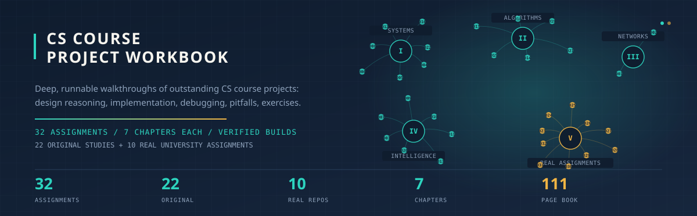
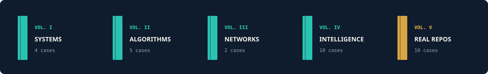
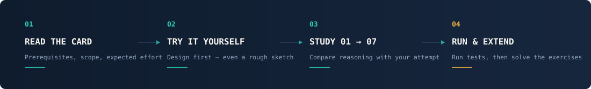

<div align="center">



**Deep, runnable walkthroughs of university CS capstones.**

[中文版本](README.zh-CN.md) · [The Book](book/README.md) · [Contributing](CONTRIBUTING.md) · [License](LICENSE)

</div>

---

## Why this exists

Public course projects are excellent — but the material online is usually scattered code. What's missing is the reasoning: *why* a design was chosen, *where* implementations break, and *how* to prove your version is correct.

This is a **study workbook**, not an answer dump. Every problem is decomposed into the decisions a student actually has to make, and every claim is anchored to something you can run and verify.



- **32 assignments**: 22 original walkthroughs + 10 real university assignments integrated as git submodules.
- **Seven chapters per problem**: problem reading → design → step-by-step implementation → correctness & complexity → debugging → pitfalls → extensions.
- **Bilingual throughout**: every chapter pairs Chinese exposition with an English summary.
- **Verified, not asserted**: reference implementations run against official or carefully reconstructed tests; numbers in the docs come from actual runs.
- **Academic integrity**: official statements are referenced, original materials are preserved in `source-handout.md`, and implementations are written independently.

## The book

The walkthroughs are also typeset as a Quarto book — five volumes, HTML and PDF (111 pages).

```bash
bash scripts/build-book.sh all
# HTML → book/_site/   ·   PDF → book/_book/
```

See [book/README.md](book/README.md) for the chapter map.

## Catalog

| # | Problem | Source | Area | Status |
|:--|:--|:--|:--|:--|
| [001](problems/001-mit-6.824-raft/README.md) | MIT 6.824 Raft | MIT | Distributed systems | ✅ |
| [002](problems/002-stanford-cs144-tcp/README.md) | Stanford CS144 TCP | Stanford | Networking | ✅ |
| [003](problems/003-berkeley-cs188-pacman/README.md) | UC Berkeley CS188 Pacman | UC Berkeley | Artificial intelligence | ✅ |
| [004](problems/004-berkeley-cs61b-gitlet/README.md) | UC Berkeley CS61B Gitlet | UC Berkeley | Data structures | ✅ |
| [005](problems/005-mit-6.1810-xv6/README.md) | MIT 6.1810 xv6 | MIT | Operating systems | ✅ |
| [006](problems/006-cmu-csapp-malloc-lab/README.md) | CMU CSAPP Malloc Lab | CMU | Systems | ✅ |
| [007](problems/007-stanford-cs143-compiler/README.md) | Stanford CS143 Compiler | Stanford | Compilers | ✅ |
| [008](problems/008-cmu-15445-buffer-pool/README.md) | CMU 15-445 Buffer Pool | CMU | Databases | ✅ |
| [009](problems/009-stanford-cs155-crypto/README.md) | Stanford CS155 Crypto | Stanford | Cryptography | ✅ |
| [010](problems/010-stanford-cs248-raytracer/README.md) | Stanford CS248 Raytracer | Stanford | Graphics | ✅ |
| [011](problems/011-stanford-cs231n-neuralnet/README.md) | Stanford CS231n Neural Net | Stanford | Machine learning | ✅ |
| [012](problems/012-ucb-cs61c-cache/README.md) | UC Berkeley CS61C Cache | UC Berkeley | Architecture | ✅ |
| [013](problems/013-ucb-cs61a-scheme/README.md) | UC Berkeley CS61A Scheme | UC Berkeley | Programming languages | ✅ |
| [014](problems/014-princeton-cos226-8puzzle/README.md) | Princeton COS226 8-Puzzle | Princeton | Algorithms | ✅ |
| [015](problems/015-stanford-cs106b-boggle/README.md) | Stanford CS106B Boggle | Stanford | Backtracking | ✅ |
| [016](problems/016-mit-shell/README.md) | MIT Shell Parser | MIT | Systems programming | ✅ |
| [017](problems/017-cmu-geometry/README.md) | CMU 15-112 Geometry | CMU | Computational geometry | ✅ |
| [018](problems/018-mit-6602-lru-cache/README.md) | MIT 6.006 LRU Cache | MIT | Data structures | ✅ |
| [019](problems/019-gatech-bloom-filter/README.md) | Georgia Tech Bloom Filter | Georgia Tech | Probabilistic structures | ✅ |
| [020](problems/020-cornell-enigma/README.md) | Cornell CS3110 Enigma | Cornell | Cryptography | ✅ |
| [021](problems/021-stanford-kruskal/README.md) | Stanford Kruskal MST | Stanford | Graph algorithms | ✅ |
| [022](problems/022-cs106l-scoped-handle/README.md) | CS106L ScopedHandle (workshop) | Stanford style | Modern C++ / RAII | ✅ |
| [023](problems/023-amirkabir-ap1400-hw1/README.md) | Amirkabir AP1400 HW1 | Amirkabir | C++ / linear algebra | ✅ |
| [024](problems/024-fordham-cisc2200-alist/README.md) | Fordham CISC2200 Lab3 | Fordham | C++ / data structures | ✅ |
| [025](problems/025-uci-ecs36c-linkedlist/README.md) | UC Irvine ECS36C HW1 | UC Irvine | C++ / linked structures | ✅ |
| [026](problems/026-uci-ics46-bst-avl/README.md) | UC Irvine ICS46 HW6 | UC Irvine | C++ / BST & AVL | ✅ |
| [027](problems/027-ccny-csc212-backtracking/README.md) | CCNY CSC212 Lab07 | CCNY | C++ / backtracking | ✅ |
| [028](problems/028-clemson-cpsc2121-liststack-queue/README.md) | Clemson CPSC2121 Lab1 | Clemson | C++ / lists & ADTs | ✅ |
| [029](problems/029-ucb-cs61b-deque61b/README.md) | UC Berkeley CS61B proj1a+1b | UC Berkeley | Java / generic deques | ✅ |
| [030](problems/030-umd-cmsc132-submitserver/README.md) | UMD CMSC132 Project1 | Maryland | Java / OOP | ✅ |
| [031](problems/031-ucsc-cse140-pacman-warmup/README.md) | UCSC CSE140 p0 | UC Santa Cruz | Python / Pacman warmup | ✅ |
| [032](problems/032-ucsc-cse140-pacman-search/README.md) | UCSC CSE140 p1 | UC Santa Cruz | Python / search | ✅ |

Every problem directory contains: an original handout (`source-handout.md`), seven bilingual chapters, a runnable `solution/`, verified `tests/`, and original follow-up exercises. Real assignments additionally keep their upstream repository as a git submodule.

## How to use



1. Open a problem card and check prerequisites and expected effort.
2. **Attempt it yourself first** — even a rough design is enough.
3. Read chapters `01` → `07` and compare with your own reasoning.
4. Run the reference implementation and tests, then solve the extension exercises.

## Repository layout

```text
.
├── README.md                # this file (English, default)
├── README.zh-CN.md          # Chinese edition
├── assets/                  # SVG artwork (generated by scripts/generate-readme-assets.py)
├── book/                    # Quarto book: five volumes, HTML + PDF
├── docs/                    # selection criteria, roadmap, academic integrity
├── templates/problem/       # template for new problems
└── problems/
    └── 023-xxx/
        ├── source-handout.md          # original assignment text
        ├── resources/                 # figures referenced by the handout
        ├── README.md + 01–07*.md      # bilingual walkthrough
        ├── upstream/                  # git submodule (real assignments only)
        ├── solution/                  # reference implementation
        └── tests/                     # verified test harness
```

## Scope and license

Original walkthroughs, implementations, and artwork are licensed under [CC BY-NC-SA 4.0](LICENSE). Assignment texts belong to their respective courses; we reference the originals, preserve them as `source-handout.md` for study, and do not provide copy-paste-ready submissions. See [docs/academic-integrity.md](docs/academic-integrity.md).

> Status: 32/32 complete — 22 original walkthroughs + 10 real university assignments.
