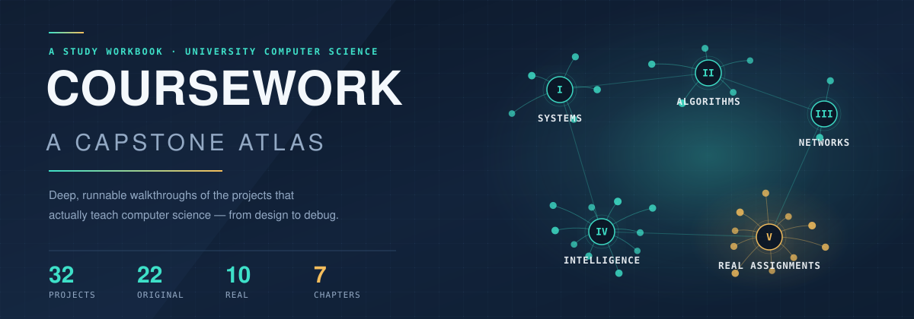

<a href="#catalog"></a>

<p align="center">
  <a href="#catalog"><strong>Start reading →</strong></a> ·
  <a href="README.zh-CN.md">中文</a> ·
  <a href="book/README.md">The Book</a> ·
  <a href="CONTRIBUTING.md">Contributing</a> ·
  <a href="docs/selection-criteria.md">Selection criteria</a>
</p>

<p align="center"></p>

<p align="center">
  <a href="https://github.com/polarours/Coursework/actions/workflows/pages.yml"></a>
  
  
  
  
</p>

---

## About

Most public course projects ship as scattered code. What's missing is the reasoning: **why** a design was chosen, **where** implementations break, and **how** to know your version is correct.

Coursework is a study workbook, not an answer dump. Each project is decomposed into the decisions a student actually makes, with every claim anchored to something runnable.

- **34 projects** — 22 original walkthroughs and 12 real university assignments kept as git submodules, with original handouts preserved.
- **Seven chapters each** — problem reading, design, implementation, correctness, debugging, pitfalls, extensions.
- **Bilingual** — Chinese exposition with English summaries throughout.
- **Verified** — implementations run against official or carefully reconstructed tests; numbers come from real runs.
- **One page per problem** — all 34 assignments are individually addressable in the book, searchable, and linkable, on top of the twelve thematic chapters.

## The book

The walkthroughs are also typeset as a Quarto book: five volumes with fourteen university profiles, published as an HTML site and a downloadable PDF.

**[Read online](https://polarours.github.io/Coursework/) · [Download the PDF](https://polarours.github.io/Coursework/coursework-atlas.pdf)**

```bash
bash scripts/build-book.sh all
# HTML → book/_site/                        ·   PDF → book/_site/coursework-atlas.pdf
```

See [book/README.md](book/README.md) for the chapter map.

## Catalog

### Original walkthroughs

| # | Problem | Source | Area |
|:--|:--|:--|:--|
| [001](problems/001-mit-6.824-raft/README.md) | MIT 6.824 Raft | MIT | Distributed systems |
| [002](problems/002-stanford-cs144-tcp/README.md) | Stanford CS144 TCP | Stanford | Networking |
| [003](problems/003-berkeley-cs188-pacman/README.md) | UC Berkeley CS188 Pacman | UC Berkeley | Artificial intelligence |
| [004](problems/004-berkeley-cs61b-gitlet/README.md) | UC Berkeley CS61B Gitlet | UC Berkeley | Data structures |
| [005](problems/005-mit-6.1810-xv6/README.md) | MIT 6.1810 xv6 | MIT | Operating systems |
| [006](problems/006-cmu-csapp-malloc-lab/README.md) | CMU CSAPP Malloc Lab | CMU | Systems |
| [007](problems/007-stanford-cs143-compiler/README.md) | Stanford CS143 Compiler | Stanford | Compilers |
| [008](problems/008-cmu-15445-buffer-pool/README.md) | CMU 15-445 Buffer Pool | CMU | Databases |
| [009](problems/009-stanford-cs155-crypto/README.md) | Stanford CS155 Crypto | Stanford | Cryptography |
| [010](problems/010-stanford-cs248-raytracer/README.md) | Stanford CS248 Raytracer | Stanford | Graphics |
| [011](problems/011-stanford-cs231n-neuralnet/README.md) | Stanford CS231n Neural Net | Stanford | Machine learning |
| [012](problems/012-ucb-cs61c-cache/README.md) | UC Berkeley CS61C Cache | UC Berkeley | Architecture |
| [013](problems/013-ucb-cs61a-scheme/README.md) | UC Berkeley CS61A Scheme | UC Berkeley | Programming languages |
| [014](problems/014-princeton-cos226-8puzzle/README.md) | Princeton COS226 8-Puzzle | Princeton | Algorithms |
| [015](problems/015-stanford-cs106b-boggle/README.md) | Stanford CS106B Boggle | Stanford | Backtracking |
| [016](problems/016-mit-shell/README.md) | MIT Shell Parser | MIT | Systems programming |
| [017](problems/017-cmu-geometry/README.md) | CMU 15-112 Geometry | CMU | Computational geometry |
| [018](problems/018-mit-6602-lru-cache/README.md) | MIT 6.006 LRU Cache | MIT | Data structures |
| [019](problems/019-gatech-bloom-filter/README.md) | Georgia Tech Bloom Filter | Georgia Tech | Probabilistic structures |
| [020](problems/020-cornell-enigma/README.md) | Cornell CS3110 Enigma | Cornell | Cryptography |
| [021](problems/021-stanford-kruskal/README.md) | Stanford Kruskal MST | Stanford | Graph algorithms |
| [022](problems/022-cs106l-scoped-handle/README.md) | CS106L ScopedHandle (workshop) | Stanford style | Modern C++ / RAII |

### Real university assignments

Each entry keeps the upstream repository as a git submodule and preserves the original handout in `source-handout.md`.

| # | Problem | Source | Area |
|:--|:--|:--|:--|
| [023](problems/023-amirkabir-ap1400-hw1/README.md) | Amirkabir AP1400 HW1 | Amirkabir | C++ / linear algebra |
| [024](problems/024-fordham-cisc2200-alist/README.md) | Fordham CISC2200 Lab3 | Fordham | C++ / data structures |
| [025](problems/025-uci-ecs36c-linkedlist/README.md) | UC Irvine ECS36C HW1 | UC Irvine | C++ / linked structures |
| [026](problems/026-uci-ics46-bst-avl/README.md) | UC Irvine ICS46 HW6 | UC Irvine | C++ / BST & AVL |
| [027](problems/027-ccny-csc212-backtracking/README.md) | CCNY CSC212 Lab07 | CCNY | C++ / backtracking |
| [028](problems/028-clemson-cpsc2121-liststack-queue/README.md) | Clemson CPSC2121 Lab1 | Clemson | C++ / lists & ADTs |
| [029](problems/029-ucb-cs61b-deque61b/README.md) | UC Berkeley CS61B proj1a+1b | UC Berkeley | Java / generic deques |
| [030](problems/030-umd-cmsc132-submitserver/README.md) | UMD CMSC132 Project1 | Maryland | Java / OOP |
| [031](problems/031-ucsc-cse140-pacman-warmup/README.md) | UCSC CSE140 p0 | UC Santa Cruz | Python / Pacman warmup |
| [032](problems/032-ucsc-cse140-pacman-search/README.md) | UCSC CSE140 p1 | UC Santa Cruz | Python / search |
| [033](problems/033-princeton-cos217-decomment/README.md) | Princeton COS217 A1 | Princeton | C / DFA and lexical edges |
| [034](problems/034-ucb-cs61c-snek/README.md) | Berkeley CS61C Proj1 | UC Berkeley | C / structs and memory |

## How to read

1. Open a project card and check prerequisites and expected effort.
2. **Attempt it yourself first** — even a rough design is enough.
3. Read chapters `01` → `07` and compare with your own reasoning.
4. Run the reference implementation and tests, then solve the extension exercises.

## How each problem is verified

Three layers, each more independent than the last:

1. **The course's own tests**, run unmodified against our implementation. If the
   starter ships tests, they are the specification, and we do not edit them.
2. **Boundary tests we add** for what the official suite never exercises — empty
   containers, null pointers, off-by-one indices, out-of-range arguments.
3. **A second implementation**, written differently on purpose, compared output
   by output. Disagreements are either a bug in one of them or a boundary the
   spec leaves open, and both are worth knowing about.

Every number quoted in the book comes from one of these runs. When a result is
an estimate rather than a measurement, the text says so. When we could not
reproduce something, it is reported as unresolved rather than smoothed over.

## Layout

```text
problems/023-xxx/
├── source-handout.md      # original assignment text
├── resources/             # figures referenced by the handout
├── README.md + 01–07*.md  # bilingual walkthrough
├── upstream/              # git submodule (real assignments only)
├── solution/              # reference implementation
└── tests/                 # verified test harness
```

Artwork in `assets/` is generated from the catalog by `scripts/generate-readme-assets.py`.

## License

Original walkthroughs, implementations, and artwork are [CC BY-NC-SA 4.0](LICENSE). Assignment texts belong to their respective courses — referenced, preserved for study, never presented as copy-paste-ready submissions. See [academic integrity](docs/academic-integrity.md).

> 34/34 complete — 22 original walkthroughs + 12 real university assignments.
