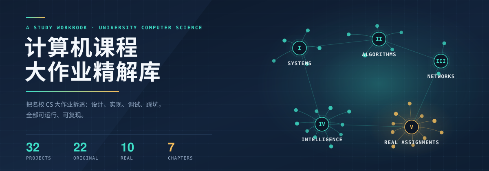

<a href="#catalog"></a>

<p align="center">
  <a href="#catalog"><strong>开始阅读 →</strong></a> ·
  <a href="README.md">English</a>（默认版本） ·
  <a href="book/README.md">正式成书</a> ·
  <a href="CONTRIBUTING.md">贡献指南</a> ·
  <a href="docs/selection-criteria.md">选题标准</a>
</p>

<p align="center"></p>

---

## 关于

公开课的大作业质量很高，但网上的资料往往是零散的代码。真正缺的是**设计理由**：为什么这样设计、哪里会出错、怎么验证自己写对了。

本项目是学习解构库，不是答案搬运站。每道题拆成学生真正要做的决策，每个断言都锚定在能跑的东西上。

- **32 个项目** — 22 道原创精解，10 道真实高校作业以 git submodule 保留原仓库，并保存原始题面。
- **每题七章** — 题目解读、设计、实现、正确性、调试、踩坑、延伸。
- **中英双语** — 中文讲解配英文摘要。
- **实测得出** — 参考实现跑官方或严格复原的测试，文档里的数字来自真实运行。

## 正式成书

所有精解也排成了一部 Quarto 书：五卷、HTML 与 PDF（111 页）。

```bash
bash scripts/build-book.sh all
# HTML → book/_site/   ·   PDF → book/_book/
```

章节地图见 [book/README.md](book/README.md)。

## 题目清单

### 原创精解

| # | 题目 | 来源 | 方向 |
|:--|:--|:--|:--|
| [001](problems/001-mit-6.824-raft/README.md) | MIT 6.824 Raft（共识算法） | MIT | 分布式系统 |
| [002](problems/002-stanford-cs144-tcp/README.md) | Stanford CS144 TCP | Stanford | 网络 |
| [003](problems/003-berkeley-cs188-pacman/README.md) | UC Berkeley CS188 Pacman | UC Berkeley | 人工智能 |
| [004](problems/004-berkeley-cs61b-gitlet/README.md) | UC Berkeley CS61B Gitlet | UC Berkeley | 数据结构 |
| [005](problems/005-mit-6.1810-xv6/README.md) | MIT 6.1810 xv6 | MIT | 操作系统 |
| [006](problems/006-cmu-csapp-malloc-lab/README.md) | CMU CSAPP Malloc Lab | CMU | 系统 |
| [007](problems/007-stanford-cs143-compiler/README.md) | Stanford CS143 编译器 | Stanford | 编译器 |
| [008](problems/008-cmu-15445-buffer-pool/README.md) | CMU 15-445 Buffer Pool | CMU | 数据库 |
| [009](problems/009-stanford-cs155-crypto/README.md) | Stanford CS155 密码学构件 | Stanford | 密码学与安全 |
| [010](problems/010-stanford-cs248-raytracer/README.md) | Stanford CS248 光线追踪器 | Stanford | 图形学 |
| [011](problems/011-stanford-cs231n-neuralnet/README.md) | Stanford CS231n 两层神经网络 | Stanford | 机器学习 |
| [012](problems/012-ucb-cs61c-cache/README.md) | UC Berkeley CS61C Cache | UC Berkeley | 计算机组成 |
| [013](problems/013-ucb-cs61a-scheme/README.md) | UC Berkeley CS61A Scheme | UC Berkeley | 编程语言 |
| [014](problems/014-princeton-cos226-8puzzle/README.md) | Princeton COS226 8-Puzzle | Princeton | 算法 |
| [015](problems/015-stanford-cs106b-boggle/README.md) | Stanford CS106B Boggle | Stanford | 回溯搜索 |
| [016](problems/016-mit-shell/README.md) | MIT Shell 解析器 | MIT | 系统编程 |
| [017](problems/017-cmu-geometry/README.md) | CMU 15-112 计算几何 | CMU | 几何 |
| [018](problems/018-mit-6602-lru-cache/README.md) | MIT 6.006 LRU 缓存 | MIT | 数据结构 |
| [019](problems/019-gatech-bloom-filter/README.md) | Georgia Tech 布隆过滤器 | Georgia Tech | 概率数据结构 |
| [020](problems/020-cornell-enigma/README.md) | Cornell CS3110 Enigma | Cornell | 密码学 |
| [021](problems/021-stanford-kruskal/README.md) | Stanford Kruskal MST | Stanford | 图算法 |
| [022](problems/022-cs106l-scoped-handle/README.md) | CS106L ScopedHandle（作业包） | Stanford 风格 | 现代 C++ / RAII |

### 真实高校作业

每题以 git submodule 保留上游仓库，原始题面存于 `source-handout.md`。

| # | 题目 | 来源 | 方向 |
|:--|:--|:--|:--|
| [023](problems/023-amirkabir-ap1400-hw1/README.md) | Amirkabir AP1400 HW1 | Amirkabir | C++ / 线性代数 |
| [024](problems/024-fordham-cisc2200-alist/README.md) | Fordham CISC2200 Lab3 | Fordham | C++ / 数据结构 |
| [025](problems/025-uci-ecs36c-linkedlist/README.md) | UC Irvine ECS36C HW1 | UC Irvine | C++ / 链表栈队列 |
| [026](problems/026-uci-ics46-bst-avl/README.md) | UC Irvine ICS46 HW6 | UC Irvine | C++ / BST 与 AVL |
| [027](problems/027-ccny-csc212-backtracking/README.md) | CCNY CSC212 Lab07 | CCNY | C++ / 回溯 |
| [028](problems/028-clemson-cpsc2121-liststack-queue/README.md) | Clemson CPSC2121 Lab1 | Clemson | C++ / 链表栈队列 |
| [029](problems/029-ucb-cs61b-deque61b/README.md) | UC Berkeley CS61B proj1a+1b | UC Berkeley | Java / 泛型链表 |
| [030](problems/030-umd-cmsc132-submitserver/README.md) | UMD CMSC132 Project1 | Maryland | Java / OOP |
| [031](problems/031-ucsc-cse140-pacman-warmup/README.md) | UCSC CSE140 p0 | UC Santa Cruz | Python / Pacman warmup |
| [032](problems/032-ucsc-cse140-pacman-search/README.md) | UCSC CSE140 p1 | UC Santa Cruz | Python / 搜索 |

## 怎么读

1. 打开题目卡片，确认前置知识与预计耗时。
2. **先自己做一遍**——哪怕只画出大致设计。
3. 按 `01 → 07` 顺序读精解，对照自己的思路。
4. 跑通参考实现和测试，再挑战延伸练习。

## 目录结构

```text
problems/023-xxx/
├── source-handout.md      # 原始题面
├── resources/             # 题面配图
├── README.md + 01–07*.md  # 双语精解
├── upstream/              # git submodule（仅真实作业）
├── solution/              # 参考实现
└── tests/                 # 验证脚本
```

`assets/` 中的配图由 `scripts/generate-readme-assets.py` 根据题目清单生成。

## 许可

原创精解、实现与配图采用 [CC BY-NC-SA 4.0](LICENSE)。题目原文归各课程所有——引用、保留供学习，绝不包装成可直接提交的答案。详见[学术诚信](docs/academic-integrity.md)。

> 32/32 完成——22 道原创精解 + 10 道真实高校作业。
