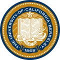

# UC Berkeley (加州大学伯克利分校)

The public university where UNIX was born, and where the CS61 series became a model for teaching systems and data structures.

> 这所公立大学是 UNIX 的诞生地，它的 CS61 系列课程成为系统和数据结构教学的典范。

## Background (背景)

Founded in 1868 by merging the College of California with the state's Agricultural, Mining and Mechanical Arts College, Berkeley opened with 10 faculty and 40 students and moved to its present site in 1873.

> 伯克利成立于 1868 年，由加利福尼亚学院与州立农矿机械工艺学院合并而成，开办时有 10 名教师、40 名学生，1873 年迁至现址。

## Notable people (名人)

**Ken Thompson** (BS '65, MS '66) — principal inventor of UNIX and 1983 Turing Award recipient. **Richard Karp** — Berkeley professor emeritus, 1985 Turing Award for NP-completeness. **Eric Brewer** — formulated the CAP Theorem and contributed to cloud computing foundations.

> **Ken Thompson**（1965 学士、1966 硕士）— UNIX 主要发明者、1983 年图灵奖得主。**Richard Karp** — 伯克利荣休教授，因 NP 完全性获 1985 年图灵奖。**Eric Brewer** — 提出 CAP 定理，奠定云计算基础。

## Notable CS courses (著名计算机课程)

CS61A Structure and Interpretation of Computer Programs · CS61B Data Structures · CS61C Machine Structures · CS170 Efficient Algorithms · CS188 Introduction to Artificial Intelligence.

> CS61A 计算机程序的构造与解释 · CS61B 数据结构 · CS61C 机器结构 · CS170 高效算法 · CS188 人工智能导论。

## In this book (本书收录)

- [003](https://github.com/polarours/Coursework/tree/master/problems/003-berkeley-cs188-pacman) — Pacman (CS188)
- [004](https://github.com/polarours/Coursework/tree/master/problems/004-berkeley-cs61b-gitlet) — Gitlet (CS61B)
- [012](https://github.com/polarours/Coursework/tree/master/problems/012-ucb-cs61c-cache) — Cache simulator (CS61C)
- [013](https://github.com/polarours/Coursework/tree/master/problems/013-ucb-cs61a-scheme) — Scheme interpreter (CS61A)
- [029](https://github.com/polarours/Coursework/tree/master/problems/029-ucb-cs61b-deque61b) — Deque61B (CS61B proj1a+1b)

## Sources (来源)

- <https://www.berkeley.edu/about/history-discoveries/>
- <https://amturing.acm.org/award_winners/karp_3256708.cfm>
- <https://www2.eecs.berkeley.edu/Courses/CS/>
- <https://undergraduate.catalog.berkeley.edu/courses/1042871>
