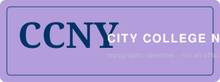

::: {.uni-head}
{.uni-plate width=210px}

::: {.uni-head-text}
**The Free Academy that gave us TCP/IP**

孕育 TCP/IP 的免费学院
:::
:::

::: {.uni-intro}
The 'Free Academy' of 1847 — a public college whose alumni include the co-inventor of TCP/IP and Intel's CEO.
:::

> 1847 年的“免费学院”——这所公立学校的校友包括 TCP/IP 的共同发明者和 Intel 的 CEO。

## Why it matters (为何重要)

CCNY's tuition-free origins produced an extraordinary alumni line — Bob Kahn, Leonard Kleinrock, Andy Grove.

> CCNY 免学费的出身造就了非凡的校友谱系——Bob Kahn、Kleinrock、Grove。

## Background (背景)

Established in 1847 as the Free Academy, CCNY is the founding institution of the City University of New York. Its CS department was founded in 1968, the first CUNY college to offer a CS major.

> 1847 年以“免费学院”之名创立，是纽约城市大学（CUNY）的发源校。计算机系成立于 1968 年，是 CUNY 首个开设计算机专业的高校。

## People (人物)

| Person | Connection to computing |
|:--|:--|
| — | **Robert E. Kahn** (class of 1960) — co-invented TCP/IP and shared the 2004 Turing Award. **Leonard Kleinrock** (1957) — Internet pioneer. **Andrew Grove** (1960) — became Intel's CEO. |

> **Robert E. Kahn**（1960 届）— TCP/IP 共同发明者，2004 年图灵奖得主。**Leonard Kleinrock**（1957 届）— 互联网先驱。**Andrew Grove**（1960 届）— 后任 Intel CEO。

## Courses (课程)

| Course | Title |
|:--|:--|
| CSC 212 | Data Structures (Lab 07 is project 027) |
| — | BS/MS/PhD in Computer Science |
| — | BE in Computer Engineering |
| — | research through the Center for Algorithms and Interactive Scientific Software |

> CSC 212 数据结构（Lab 07 即项目 027）· 计算机科学学士/硕士/博士 · 计算机工程学士 · 通过算法与交互科学软件中心开展研究。

## In this book (本书收录)

- [027 · Backtracking lab (CSC 212)](https://github.com/polarours/Coursework/tree/master/problems/027-ccny-csc212-backtracking)

**The backtracking lab asks for the same three recursions CSC 212 always taught: N-Queens, Sudoku and Sujiko, one choose-recurse-unchoose skeleton.**

> 回溯实验要求的正是 CSC 212 一贯教的三种递归：N-Queens、Sudoku 与 Sujiko，共用一套“选择-递归-撤销”骨架。

## Sources (来源)

- <https://www.ccny.cuny.edu/compsci/about-us>
- <https://ccny-undergraduate.catalog.cuny.edu/programs/CMPSC-BS>
- <https://en.wikipedia.org/wiki/List_of_City_College_of_New_York_alumni>

---

*University identifiers are editorial nameplates, not official crests. Logos for MIT, Stanford, Berkeley and CMU are redistributed under an MIT-licensed open course-map project. All other institutions are represented by nameplates generated from `scripts/gen-university-wordmarks.py`.*
