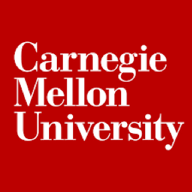

Official mark, redistributed under an MIT-licensed open course-map project.

**CSAPP as a way of thinking**

> CSAPP 是一种思维方式

## Why it matters (为何重要)

Carnegie Mellon made the machine itself the subject: 15-213 teaches you to see what the hardware actually does.

> 卡内基梅隆把机器本身作为主题：15-213 教你看见硬件到底在做什么。

## Background (背景)

Founded in 1900 when Andrew Carnegie gave $1 million for the Carnegie Technical Schools, it became the Carnegie Institute of Technology in 1912 and merged with the Mellon Institute in 1967.

> 1900 年 Andrew Carnegie 捐赠 100 万美元创办卡内基技术学校，1912 年更名为卡内基理工学院，1967 年与梅隆学院合并。

## People (人物)

| Person | Connection to computing |
|:--|:--|
| Manuel Blum | 1995 Turing Award for computational complexity, cryptography and program checking. **Allen Newell** and |
| Herbert A. Simon | shared the 1975 Turing Award for AI and human cognition |
| Raj Reddy | 1994 Turing Award for large-scale AI systems |

> **Manuel Blum** — 因计算复杂性、密码学与程序检验获 1995 年图灵奖。**Allen Newell** 与 **Herbert A. Simon** — 因人工智能与人类认知共享 1975 年图灵奖。**Raj Reddy** — 因大规模 AI 系统获 1994 年图灵奖。

## Courses (课程)

| Course | Title |
|:--|:--|
| — | 15-112 Fundamentals of Programming |
| — | 15-210 Parallel and Sequential Data Structures |
| — | 15-213 Introduction to Computer Systems (CSAPP) |
| — | 15-410 Operating System Design |
| — | 15-281 Artificial Intelligence |

> 15-112 编程基础 · 15-210 并行与顺序数据结构 · 15-213 计算机系统导论（CSAPP）· 15-410 操作系统设计 · 15-281 人工智能。

## In this book (本书收录)

- [006](https://github.com/polarours/Coursework/tree/master/problems/006-cmu-csapp-malloc-lab) — Malloc Lab (CSAPP)
- [008](https://github.com/polarours/Coursework/tree/master/problems/008-cmu-15445-buffer-pool) — Buffer pool (15-445)
- [017](https://github.com/polarours/Coursework/tree/master/problems/017-cmu-geometry) — Computational geometry (15-112)

**The Malloc Lab is CSAPP distilled: understand the allocator because you wrote one. Buffer pool and geometry continue that hands-on tradition.**

> Malloc Lab 是 CSAPP 的浓缩：因为亲手写过分配器，所以真正理解它。缓冲池与几何作业延续了这种动手传统。

## Sources (来源)

- <https://www.cmu.edu/about/history>
- <https://amturing.acm.org/award_winners/blum_4659082.cfm>
- <https://www.cs.cmu.edu/~scsfacts/turing.html>
- <https://coursecatalog.web.cmu.edu/schools-colleges/schoolofcomputerscience/courses/courses.pdf>

---

*University identifiers are editorial nameplates, not official crests. Logos for MIT, Stanford, Berkeley and CMU are redistributed under an MIT-licensed open course-map project. All other institutions are represented by nameplates generated from `scripts/gen-university-wordmarks.py`.*
