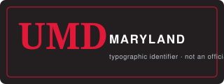

Editorial nameplate — not an official crest. Generated from `scripts/gen-university-wordmarks.py`.

**The systems school next to the capital**

> 首都旁的系统学派

## Why it matters (为何重要)

Maryland's CS department spans human-computer interaction, graphics and programming languages — CMSC 132 is its OO gateway.

> 马里兰的 CS 横跨人机交互、图形学与编程语言，CMSC 132 是它的面向对象入口。

## Background (背景)

Chartered in 1856 as the Maryland Agricultural College and opened in 1859 with 34 students, it became a land-grant college in 1864.

> 1856 年以“马里兰农业学院”之名获特许成立，1859 年招收 34 名学生，1864 年成为赠地学院。

## People (人物)

| Person | Connection to computing |
|:--|:--|
| Sergey Brin | BS with honors in mathematics and CS (1993), co-founder of Google |
| Ben Shneiderman | Distinguished Professor in HCI, ACM Fellow and NAE member |
| Victor Basili | founder of NASA Goddard's Software Engineering Laboratory |
| Hanan Samet | quadtree pioneer and 2012 ACM Paris Kanellakis Award winner |

> **Sergey Brin** — 1993 年数学与计算机荣誉学士，Google 联合创始人。**Ben Shneiderman** — 人机交互杰出教授、ACM 会士、美国工程院院士。**Victor Basili** — NASA Goddard 软件工程实验室创始人。**Hanan Samet** — 四叉树先驱、2012 年 ACM Paris Kanellakis 奖得主。

## Courses (课程)

| Course | Title |
|:--|:--|
| CMSC 132 | Object-Oriented Programming II |
| CMSC 216 | Introduction to Computer Systems |
| CMSC 330 | Organization of Programming Languages |
| CMSC 351 | Algorithms |
| CMSC 451 | Design and Analysis of Algorithms |

> CMSC 132 面向对象编程 II · CMSC 216 计算机系统导论 · CMSC 330 编程语言结构 · CMSC 351 算法 · CMSC 451 算法设计与分析。

## In this book (本书收录)

- [030 · SubmitServer (CMSC 132)](https://github.com/polarours/Coursework/tree/master/problems/030-umd-cmsc132-submitserver)

**SubmitServer turns CMSC 132's 'tests as spec' habit into a lesson: the public tests ARE the requirements, and undefined corners are yours to decide.**

> SubmitServer 把 CMSC 132 的“测试即规格”变成一课：公开测试就是需求，未定义的边界由你自己定。

## Sources (来源)

- <https://umd.edu/about/history>
- <https://www.cs.umd.edu/community/alumnus/sergey-brin>
- <https://www.cs.umd.edu/people/bshneide>
- <https://undergrad.cs.umd.edu/degree-requirements-cs-major>

---

*University identifiers are editorial nameplates, not official crests. Logos for MIT, Stanford, Berkeley and CMU are redistributed under an MIT-licensed open course-map project. All other institutions are represented by nameplates generated from `scripts/gen-university-wordmarks.py`.*
