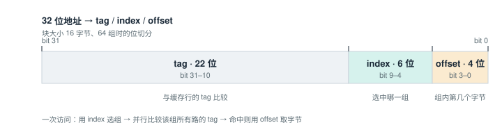

::: {.callout-note}
## Purpose (本章目标)

理解地址如何划分为 tag/index/offset；区分为容量而缺失与为冲突而缺失；用真实命中率与 AMAT 把"局部性"变成可计算的东西；看懂 LRU 为什么能在 O(1) 内完成查找与淘汰。

> **English:** Decompose an address into tag, index and offset; tell capacity misses from conflict misses; turn "locality" into a computable number with hit rate and AMAT; see why LRU can be O(1) end to end.
:::

::: {.callout-tip}
## Projects in this chapter (本章项目与来源高校)

[012 UC Berkeley](../universities/berkeley.qmd) · [018 MIT](../universities/mit.qmd)
:::

## 存储层次存在的理由 / Why the hierarchy exists

一个 3 GHz 的核，一个时钟周期约 0.33 ns。L1 命中约 1 ns（3 个周期），L2 约 4 ns，主存约 60–100 ns，磁盘以毫秒计。如果每次取指取数都去主存，再快的核也只能跑到几十 MHz 的有效速度。

存储层次的前提是**程序访问有规律**：刚用过的会被再用（时间局部性），用过的邻居很快会被用到（空间局部性）。缓存的所有设计——块大小、相联度、替换策略——都是在赌这个前提成立，并且在它不成立时尽量少付代价。

> **English:** The hierarchy only works because programs reuse data and reuse neighbours. Every cache parameter is a bet on that regularity, plus a plan for when the bet loses.

## 地址的三个部分 / Three parts of an address

CS61C 的缓存实验从一个除法开始：

```text
offset     = addr        % block_size
block_addr = addr        // block_size
set        = block_addr  % num_sets
tag        = block_addr  // num_sets
```

当 `block_size` 与 `num_sets` 都是 2 的幂时，这四步除法等价于**切位**。设 32 位地址、块大小 16 字节（4 位 offset）、64 组（6 位 index）：

| 字段 | 位宽 | 位置 | 作用 |
|---|---|---|---|
| tag | 22 位 | bit 31–10 | 与缓存行的 tag 比较，确认是不是同一个块 |
| index | 6 位 | bit 9–4 | 选中哪一组 |
| offset | 4 位 | bit 3–0 | 组内块中的第几个字节 |

{#fig-addr-split width=100%}

一次访问的硬件动作：用 index 找到组 → 并行比较该组所有路的 tag → 命中则用 offset 取字节。

**为什么块大小必须是 2 的幂？** 因为位切分要求字段宽度是整数位。非 2 的幂需要真正的除法器，在关键路径上不能接受。

> **English:** Power-of-two sizes turn four divisions into bit slicing; anything else would put a divider on the critical path.

## 局部性是可以测的 / Locality is measurable

同一份模拟器，两种访问模式：

| 访问模式 | 命中 | 缺失 | 命中率 | 原因 |
|---|---|---|---|---|
| 顺序遍历（步长 4 字节） | 32 | 32 | **0.50** | 一个块装多个字，只有每块第一次缺失 |
| 跨步 64 个字（步长 256 字节） | 0 | 4 | **0.00** | 每次访问都落在新块，块内其余位置从未被用 |

这两个数字不是"缓存快慢"的比喻，而是同一个缓存、同一份代码、只改步长之后的结果。命中率 0.50 意味着平均每次访问只需要付半次内存延迟——这就是空间局部性的全部价值。

```text
[cache] sequential={'hits': 32, 'misses': 32, 'hit_rate': 0.5}
[cache] stride-64={'hits': 0, 'misses': 4, 'hit_rate': 0.0}
```

> **English:** Same cache, same loop, one constant changed: 0.50 versus 0.00. That gap is spatial locality, measured rather than asserted.

## 三类缺失 / The three Cs

每个缺失都能归到一类，这个分类决定了该改什么：

| 类型 | 何时发生 | 对应的修法 |
|---|---|---|
| **强制缺失**（compulsory） | 这个块从来没被访问过 | 无解（预取只能减少代价，不能消除） |
| **容量缺失**（capacity） | 块访问过，但被别的块挤出，而缓存装不下全部工作集 | 加大缓存；改善数据布局 |
| **冲突缺失**（conflict） | 块访问过，缓存也有空位，但被映射到同一组而挤掉 | 提高相联度；改布局避开同组 |

区分容量与冲突的经典办法是**把同一程序在一个完全相联缓存上再跑一遍**：完全相联没有冲突，剩下的缺失只有强制与容量。两者之差就是冲突缺失。

诊断路径很实用：**如果提高相联度没有改善命中率，那缺失是容量性的，继续加相联度是浪费硬件。**

## 冲突缺失的完整演示 / Conflict misses, end to end

2 个组、块大小 4 的直接映射缓存，访问序列 `[0, 4, 8, 0, 8]`：

| 地址 | 块地址 | 组 | tag | 结果 |
|---|---|---|---|---|
| 0 | 0 | 0 | 0 | miss（强制） |
| 4 | 1 | 1 | 0 | miss（强制） |
| 8 | 2 | 0 | 1 | miss（冲突：组 0 被 tag 0 占着） |
| 0 | 0 | 0 | 0 | miss（冲突：刚才 tag 1 把 tag 0 挤掉了） |
| 8 | 2 | 0 | 1 | miss（冲突：又被换回来了） |

五次访问五次缺失，命中率 0。改成 2 路组相联后，同组的两个 tag 可以共存：

```text
[cache] direct-mapped seq=[0, 4, 8, 0, 8] results=['miss', 'miss', 'miss', 'miss', 'miss']
[cache] 2-way        seq=[0, 4, 8, 0, 8] results=['miss', 'miss', 'miss', 'hit',  'hit']
```

前三次仍是强制缺失（三个不同的块），后两次变成命中。**硬件成本是多一组比较器，收益是把这两个地址的冲突彻底消掉。**

> **English:** Five compulsory-plus-conflict misses become three compulsory misses; the price is one extra comparator per way.

## 平均内存访问时间 / Average memory access time

命中率本身不是目的，延迟才是。核心公式：

```text
AMAT = hit_time + miss_rate × miss_penalty
```

用顺序访问举例。设 L1 命中 1 ns、L2 命中 4 ns，L1 命中率 0.50（假设所有缺失都在 L2 命中）：

```text
AMAT = 1 + 0.50 × (4 - 1) = 2.5 ns
```

再用跨步访问的 0.00：

```text
AMAT = 1 + 1.00 × (4 - 1) = 4.0 ns
```

同一份代码、同一个缓存，只因为访问模式不同，每次访问的平均代价差了 1.6 倍。这个数字才是"优化数据布局"的真正动机——**改循环顺序可能比换硬件更有效**。

如果缺失穿透到主存（L2 也不命中），把两级串起来：

```text
AMAT = 1 + 0.50 × ((4 - 1) + 0.90 × (100 - 4))
```

其中 0.90 是"L1 缺失中有 90% 在 L2 也缺失"，算出 **45.7 ns**——一次主存访问把平均值拉到 L1 命中的 45 倍以上。这就是为什么 L1 命中率小数点后第二位仍然值得争。

## 替换策略：LRU 为什么能 O(1) / Why LRU is O(1)

组相联的每一组需要一个淘汰规则。LRU（Least Recently Used）淘汰最久未被访问的那一路，语义最贴近局部性，但"找出最久未用"听起来需要排序或扫描。

MIT 6.006 的 LRU Cache 题给出了标准答案：**哈希表 + 双向链表**。

- 哈希表：`key → 链表节点指针`，O(1) 定位
- 双向链表：头部是最近使用，尾部是最久未使用，O(1) 摘除与插入

一次 `get(key)`：

1. 哈希表查到节点（O(1)）
2. 把节点从当前位置摘下，插到链表头（O(1)，因为已有前后指针）
3. 返回值

一次 `put(key, value)`（缓存已满）：

1. 取链表尾节点（O(1)）
2. 从哈希表删除对应 key，从链表摘除（O(1)）
3. 新节点插到头部并写入哈希表

**关键洞察**：LRU 需要的不是"排序"，而是"最近性顺序"，而后者用链表就能维持。哈希表负责"按 key 找节点"，链表负责"按顺序淘汰"，两者互补，各自 O(1)。

实测行为（018 的用例）：

```text
get(1) 后顺序从 [2,1] 变为 [1,2]   ← 命中被提升为最近使用
put(3) 淘汰了键 2                   ← 链表尾正是最久未用
```

> **English:** LRU needs recency order, not sorting. A doubly linked list maintains the order in O(1); the hash map turns a key into a node in O(1). Neither structure alone is enough.

## 写策略 / Write policy

读缺失只有一种处理（取块）。写有两种：

| 策略 | 写命中时 | 写缺失时 | 代价 |
|---|---|---|---|
| **写通**（write-through） | 同时写缓存与下一级 | 通常不分配（write-no-allocate） | 每次写都产生下行流量 |
| **写回**（write-back） | 只写缓存，置脏位 | 通常分配（write-allocate） | 脏块被淘汰时才下行，但需要脏位与更复杂的时序 |

写回把多次写合并成一次下行，代价是**一个块被反复写、最后被淘汰时才真正写出去**。模拟器里能直接观察到这个量：

```text
[cache] writeback stats={'writebacks': 1}
```

这个 `1` 就是"脏块被淘汰"的次数。写通策略下同一个测试的该计数为 0，因为每次写都已经下行——但下行次数会远大于 1。**两个数字必须一起看**：只看 writeback 次数会误以为写回"更省"，实际要比较的是总下行字节数。

> **English:** Write-back defers traffic and needs a dirty bit; write-through pays immediately and needs none. Compare total bytes written, not eviction count.

## Fallacies and Pitfalls (常见误解)

::: {.callout-warning}
## Fallacy 1：相联度越高越好

组相联增加了比较器硬件与命中延迟（需要多路并行比较再选择）。真实设计在冲突缺失与关键路径延迟之间权衡，典型 L1 是 4–8 路，再高收益递减。

> **English:** More ways buy fewer conflict misses at the cost of comparators and hit latency.
:::

::: {.callout-warning}
## Fallacy 2：命中率高就一定快

命中率高但每次命中都要多等两个周期，未必优于命中率略低但关键路径更短的方案。判断标准是 AMAT，不是命中率。

> **English:** Hit rate is an input to AMAT, not the goal.
:::

::: {.callout-warning}
## Pitfall：用固定长度数组存任意长度的 key

018 这类 LRU 实现里，若把 key 当作固定长度字节数组拷贝，超过长度的 key 会静默截断，两个不同 key 变成同一个。必须按实际长度分配。

> **English:** Fixed-size key buffers silently truncate and alias distinct keys.
:::

## Self-Check (自测题)

1. 为什么块大小必须是 2 的幂？
2. 直接映射中地址 0 与 8 为何冲突？
3. 一个程序在直接映射缓存上命中率 0.70，在完全相联缓存上 0.85。冲突缺失占多少？如果改成 2 路组相联后命中率 0.84，说明什么？
4. 设 L1 命中 1 ns、L2 命中 5 ns、主存 80 ns，L1 命中率 0.90，L1 缺失中 20% 在 L2 也缺失。求 AMAT。
5. 为什么 LRU 不能只用哈希表实现？

<details><summary>答案</summary>

1. 地址划分用位切分实现；非 2 的幂需要除法，成本高且在关键路径上。
2. 块地址分别为 0 和 2，对 2 取模都是 0（同一组），tag 不同（0 与 1），互相挤占。
3. 冲突缺失占 0.85 − 0.70 = **0.15**（完全相联只剩下强制与容量缺失）。改成 2 路后只回到 0.84，说明 0.15 中只有 0.14 是冲突，剩下 **0.01 仍是容量**——继续加相联度最多再拿 0.01。
4. `AMAT = 1 + 0.10 × ((5 − 1) + 0.20 × (80 − 5)) = 1 + 0.10 × (4 + 15) = 1 + 1.9 = **2.9 ns**`。
5. 哈希表只回答"这个 key 在不在"，不维护"谁最久没用"。淘汰需要顺序信息，链表提供 O(1) 的维护与摘取。

</details>

## Summary (本章小结)

缓存的有效性来自程序的时间与空间局部性；地址位切分决定了 tag/index/offset；缺失分强制、容量、冲突三类，只有后两类可以靠设计消除；判断一个缓存好不好看 AMAT 而不是命中率；LRU 用哈希表加双向链表做到 O(1)，因为最近性顺序不需要排序。

> **English:** Locality is the premise, bit slicing is the mechanism, the three Cs are the diagnosis, AMAT is the verdict, and a hash map plus a doubly linked list is why LRU is cheap.
