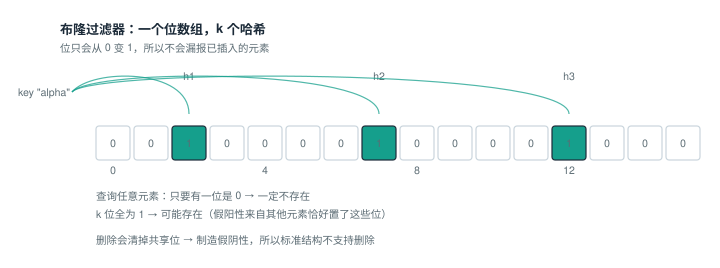

::: {.callout-note}
## Purpose (本章目标)

看清"用可控误差换空间"这一类结构的共同形状：布隆过滤器为什么绝不会有假阴性、假阳性率由什么决定、哈希函数个数为什么不是越多越好；再用实测把教科书公式对上号。最后回到缓存，把 ch02 的实现细节抽象成一条设计原则。

> **English:** See the shared shape of structures that trade certainty for space: why a Bloom filter can never produce a false negative, what sets its false-positive rate, and why more hashes stop helping. Then reduce the cache implementation from chapter 2 to one design principle.
:::

::: {.callout-tip}
## Projects in this chapter (本章项目与来源高校)

[019 Georgia Tech](../universities/gatech.qmd)
:::

## 一次交易：确定性换成空间 / The trade

精确集合成员判定，最坏情况需要存下每个元素本身（或它的完美哈希）。当元素是 URL、单词、用户 ID 这类变长字节串时，空间随元素数线性增长。

布隆过滤器把"是否存在"这个问题从**精确**降级为**大概率**：

- 说"不存在" —— **一定**正确
- 说"存在" —— 可能是误判

这个不对称是它全部价值所在：**允许假阳性，但绝不允许假阴性**。查询结果的语义因此可以安全地用于"提前拒绝"（缓存穿透保护、数据库预检），但不能用于"确认存在"。

> **English:** One-sided error is the whole design. A "no" is proof; a "yes" is a hint. That asymmetry is what makes the structure safe for early rejection and unsafe for confirmation.

{#fig-bloom-bits width=100%}

## 为什么不可能有假阴性 / Why false negatives are impossible

结构只有两样东西：一个 `m` 位的数组，和 `k` 个把元素映射到 `[0, m)` 的哈希函数。

- 插入 `x`：计算 `k` 个位置，把它们全部置 1。
- 查询 `x`：计算同样的 `k` 个位置，若全部为 1 则"可能存在"，否则"一定不存在"。

关键在于**位只会从 0 变成 1，永远不会变回 0**（标准布隆过滤器没有删除操作）。插入时置的那 `k` 个位，此后任何操作都不会清除它们，所以再查同一个元素时必然全为 1。

假阴性需要对"插入过的元素"返回"不存在"，而这要求某个被置过的位变回 0——与结构定义矛盾。

**删除是唯一会破坏这条性质的操作**，这也解释了为什么"计数布隆过滤器"要把每一位换成计数器：删除时减一，只有计数归零才真正清位。代价是空间从 `m` 位变成 `m` 个小整数。

## 假阳性率由什么决定 / What sets the false-positive rate

插入 `n` 个元素后，某一位仍为 0 的概率近似为 `e^(−kn/m)`（假设哈希均匀），因此假阳性率近似为：

```text
p ≈ (1 − e^(−k·n/m))^k
```

三个变量，只有一个真正重要：**每位元素（bits per key）的比值 `m/n`**。

对固定的 `m/n`，让 `p` 最小的 `k` 是把导数置零得到的：

```text
k* = (m/n) · ln 2 ≈ 0.693 · (m/n)
```

这条式子有两个直接推论：

1. **位越多，最优哈希数越大**。`m/n = 8` 时 `k* ≈ 5.5`，`m/n = 16` 时 `k* ≈ 11`。
2. **哈希数有上限**。`m/n = 2` 时 `k* ≈ 1.4`——位本来就少，再加哈希只会让数组更快被填满。

第 2 条是实践中最容易犯的错：直觉上"多几个哈希更保险"，实际上**超配哈希函数会让假阳性率上升**。

## 实测：把公式跑一遍 / Measured: the formula, checked

固定 `n = 1000` 个插入元素，扫描 `m/n ∈ {2, 4, 8, 16}` 与 `k ∈ {1, 2, 3, 4, 6}`，用 2 万个非成员查询统计假阳性率。

| 位/元素 | k | 理论 p | 实测 p | 置位数 |
|---:|---:|---:|---:|---:|
| 2 | 1 | 39.3% | **39.5%** | 789 |
| 2 | 3 | 46.9% | **45.7%** | 1538 |
| 2 | 6 | 73.6% | **72.2%** | 1893 |
| 4 | 1 | 22.1% | **22.0%** | 873 |
| 4 | 3 | 14.7% | **13.8%** | 2072 |
| 4 | 6 | 22.0% | **21.2%** | 3073 |
| 8 | 1 | 11.8% | **11.4%** | 927 |
| 8 | 3 | 3.1% | **3.0%** | 2469 |
| 8 | 6 | 2.2% | **2.1%** | 4180 |
| 16 | 3 | 0.5% | **0.5%** | 2718 |
| 16 | 6 | 0.1% | **0.1%** | 4995 |

四件事在这张表里同时成立：

1. **理论与实测处处吻合**（最大偏差 1.2 个百分点，出现在 `m/n = 2, k = 3`）。公式不是装饰，是可以用来选参数的。
2. **`m/n` 是主导变量**：从 2 位到 16 位，最优假阳性率从 40% 级降到 0.1% 级。
3. **`k` 有最优值**：`m/n = 4` 时 `k = 3`（13.8%）明显优于 `k = 1`（22.0%）和 `k = 6`（21.2%），与 `k* ≈ 2.77` 一致。
4. **位太少时加哈希反而更糟**：`m/n = 2` 时 `k` 从 1 加到 6，假阳性率从 39.5% 涨到 72.2%。数组只有 2000 位，6 个哈希几乎把它填满（1893/2000），此时"全 1"已经无法提供信息。

> **English:** Theory matches measurement within a point. Bits per key dominates; k has an optimum; and on a tiny array extra hashes actively hurt because the array saturates.

## 019 的冒烟测试为什么测出 0% / Why the course test reports zero

019 的官方输出是：

```text
[bloom] bit_count=9/256
[bloom] no false negatives for inserted items
[bloom] false positives: 0/1000 = 0.0%
[bloom] larger filter false positives: 0/1000
```

256 位、3 个哈希、只插入 3 个元素——置位率 9/256 ≈ 3.5%，数组几乎全空。在这个密度下假阳性率远低于 1/1000 的采样分辨率，所以"0/1000"是**测试设计的结果，不是过滤器性能的证明**。

这条输出真正验证的是两件别的事：

- **无假阴性**：插入的 3 个元素全部命中，覆盖了"位不会被清回 0"这条核心性质。
- **位数组大小正确**：`9/256` 说明 `k` 次置位落在互不冲突的位置上（3 个元素 × 3 个哈希 = 9 个不同位）。

要测出有意义的假阳性率，必须让 `n` 接近设计容量——上表就是这么做的。

> **English:** Nine bits out of 256 is a nearly empty array; zero false positives measures the test, not the filter. The run does prove no false negatives and correct bit placement.

## 缓存的另一半：把实现细节收成原则 / The cache half, reduced to one principle

ch02 已经把 LRU 的实现拆开讲过：哈希表负责"键 → 节点"，双向链表负责"最近性顺序"，两个 O(1) 拼起来才是完整的 O(1)。这里只保留它与布隆过滤器的共同点：

> **两者都不是"精确数据结构"，而是"用某种近似换取常数级操作"。**
> 布隆过滤器用假阳性换空间；LRU 用"只记住最近性、忘掉完整历史"换淘汰决策的 O(1)。

这个抽象很有用：它解释了为什么缓存永远需要**替换策略**（信息必然丢失，只能选择丢什么），也解释了为什么布隆过滤器无法删除（它的"记忆"是单向的位）。

019 的 LRU 实测（与 ch02 的实现互为印证）：

```text
[lru] after get(1): [1, 2]
[lru] after put(3): [3, 1] evictions=1
[lru] classic sequence hits=3 (expected 3), evictions=2
```

`get(1)` 之后顺序从 `[2, 1]` 变为 `[1, 2]`——命中被提升为最近使用。`put(3)` 淘汰了 `[1, 2]` 中的 `2`，因为它是链表尾。这两条行为合起来才定义 LRU：**只提升不淘汰是"最近使用列表"，只淘汰不提升是"先进先出"**。

## Fallacies and Pitfalls (常见误解)

::: {.callout-warning}
## Fallacy 1：哈希函数越多越准

假阳性率对 `k` 是个先降后升的曲线，最优值 `k* = (m/n)·ln 2`。在位数组很小时，多加哈希会让数组更快饱和，误差反而变大——实测 `m/n = 2` 时从 39.5% 恶化到 72.2%。

> **English:** k has an optimum; past it, extra hashes saturate the array and raise the error rate.
:::

::: {.callout-warning}
## Fallacy 2：布隆过滤器可以删除元素

标准布隆过滤器不能删除：清掉一位会同时"删除"其他共享这一位的元素，制造出假阴性——恰好破坏了它唯一的强保证。要支持删除必须换成计数版本，空间代价是每位数位而不是 1 位。

> **English:** Clearing a bit removes every key that hashed to it. Deletion needs counters, and counters cost space.
:::

::: {.callout-warning}
## Pitfall：用小样本测假阳性率

用 3 个元素测 256 位的过滤器会得到 0%，于是"验证"了一个不存在的性质。测假阳性率必须让 `n` 接近设计容量，并用足够大的查询样本（上表用 2 万次）把统计噪声压下去。

> **English:** A sparse filter always reports zero; measure near design capacity.
:::

::: {.callout-warning}
## Pitfall：把"可能存在"当成"存在"

布隆过滤器的肯定回答只是"没被排除"。把它用作权限校验、去重写入的正确性依据，会在假阳性上静默丢数据。它适合做**前置过滤**：说不存在就跳过，说可能存在再去查真源。

> **English:** Use a Bloom filter to skip work, never to make a decision that requires certainty.
:::

## Self-Check (自测题)

1. 为什么布隆过滤器不可能有假阴性，却一定有假阳性？
2. `m/n = 8` 时最优哈希数是多少？如果实现里用了 `k = 12`，假阳性率会往哪个方向变？
3. 上表 `m/n = 2, k = 6` 的假阳性率是 72.2%，比 `k = 1` 的 39.5% 高。用置位数解释这个现象。
4. 为什么 LRU 的"命中后移到最前"不能省略？
5. 布隆过滤器与 LRU 在"用近似换常数"这件事上分别舍弃了什么？

<details><summary>答案</summary>

1. 插入时置位、位不会被清回 0，所以插入过的元素查询必全为 1——无假阴性。假阳性来自"其他元素恰好把这些位置成了 1"，这是哈希碰撞的必然结果，只能降低概率，不能消除。
2. `k* = 8 × 0.693 ≈ 5.5`，取 5 或 6。用 `k = 12` 是明显超配：每次插入置 12 位，数组饱和更快，假阳性率上升。
3. `k = 6` 时 2000 位里已有 1893 位为 1（94.6%），查询任意键几乎必然全中；`k = 1` 时只有 789 位（39.5%），仍有大量 0 位可用于排除。**饱和让"存在"这个回答失去信息量**。
4. 省略之后链表顺序不再反映使用时间，淘汰时取到的"尾部"可能是刚被访问过的元素——那就退化成 FIFO 甚至随机淘汰。
5. 布隆过滤器舍弃"存在性判断的确定性"（允许假阳性），换来 O(m) 位的空间；LRU 舍弃"完整访问历史"，只保留最近性顺序，换来 O(1) 的淘汰决策。

</details>

## Summary (本章小结)

布隆过滤器用单向的位数组换空间：位只会置 1，所以没有假阴性；假阳性率由 `m/n` 主导，最优哈希数 `k* = (m/n)·ln 2`，超配反而变差（实测 39.5% → 72.2%）。教科书公式与实测在四个数量级上吻合，说明它可以用来选参数。LRU 是同一类交易的另一个形态：舍弃完整历史，只保留最近性，换来 O(1) 淘汰。两者共同的设计原则是——**先明确允许失去什么，再谈复杂度**。

> **English:** One-way bits remove false negatives; bits-per-key dominates the error; overshooting k hurts. LRU trades history for constant-time eviction. Both start by deciding what may be lost.
