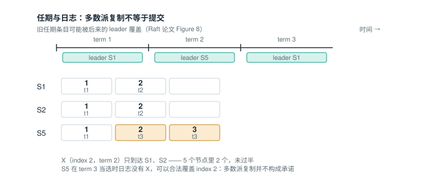

::: {.callout-note}
## Purpose (本章目标)

看清 Raft 用"强 leader"把共识拆成三个可以分别推理的子问题（选举、复制、安全），并理解为什么**提交规则里那个 term 检查不能省**——省掉之后系统在绝大多数时间里看起来完全正常，只在特定故障序列下丢数据。最后用一个真实的分区实验把这条安全性跑出来。

> **English:** See how a strong leader splits consensus into three separately-reasoned problems, and why the term check in the commit rule cannot be dropped: omit it and the system looks correct in almost every run, losing data only under a specific failure sequence. Then watch a real partition experiment exercise that guarantee.
:::

::: {.callout-tip}
## Projects in this chapter (本章项目与来源高校)

[001 MIT](../universities/mit.qmd)
:::

## 共识承诺了什么 / What consensus actually promises

一个共识协议要让一组节点对"日志里第 n 条是什么"达成一致，同时满足三条：

| 性质 | 含义 | 违反的后果 |
|---|---|---|
| **一致性**（agreement） | 没有两个节点在同一位置提交不同的命令 | 数据分叉 |
| **有效性**（validity） | 被提交的命令必须是某个客户端真实提出过的 | 凭空产生数据 |
| **终止性**（termination） | 只要多数节点存活且能通信，就一定能推进 | 系统卡死 |

前两条是安全性（safety），任何时候都不能违反；第三条是活性（liveness），只在"多数派可用"的前提下承诺。**这个区分是理解整个协议的关键**：安全性没有"大多数时候"，一次违反就是永久的数据损坏。

## 强 leader：把问题拆开 / Strong leadership decomposes the problem

Paxos 允许任何节点提议，正确性证明因此要在"提议并发交错"的空间里展开。Raft 的选择是**同一时刻只有一个 leader 接受客户端命令**，日志只能从 leader 流向 follower。

这一条约束换来的是推理上的简化：

- 日志的**唯一写入点**是 leader，所以"两个节点在同一位置有不同条目"只可能由 leader 更替引起。
- 由这一点出发，全部安全性归结为一个问题：**新 leader 必须拥有所有已提交的条目**。

整个协议的设计——任期、投票限制、提交规则——都是为这一条服务。

> **English:** One writer means the only way logs can disagree is a leader change, so all of safety reduces to: a new leader must already hold every committed entry.

## 任期：一个逻辑时钟 / Terms as a logical clock

每个任期（term）是一个单调递增的整数，一次选举对应一个新任期。任期的作用不是排序事件，而是**让节点能判断"这条消息是否过时"**：

- 收到更大 term 的请求 → 立刻退位，更新自己的 term
- 收到更小 term 的请求 → 拒绝，并告知对方自己的 term
- 同一 term 内每个节点最多投一票（`votedFor` 持久化）

第二条容易被忽略：**拒绝旧 leader 的 AppendEntries 是防止"僵尸 leader"写入的唯一手段**。分区恢复后，旧 leader 会继续发心跳，follower 必须靠 term 比较把它挡掉。

## 选举：随机化是必需的 / Randomization is not a nicety

如果所有 follower 的超时时间相同，一次 leader 失效会让它们同时发起选举，全部平票，然后同时超时、同时再选——这个循环可能持续很久（理论上无界）。

Raft 的解法是**给每个节点的选举超时加随机抖动**（典型 150–300 ms）。抖动让某个节点先超时、先拉到票、先成为 leader。

实测（4 次 RPC 完成一次选举）：

```text
[TestElection] 选出 leader=node 1, term=1, RPC 总数=4
```

3 个节点的集群，4 次 RPC 就完成了选举：1 次 RequestVote 广播给两个 follower（2 次 RPC），2 次返回，加上心跳。**这个数字说明选举在最顺利的情况下代价很低**——它不是瓶颈。

## 日志复制：两条必须记住的性质 / Two properties of replication

**日志匹配性质**：如果两个日志在某个 index 上的条目有相同的 term，那么该 index 之前的所有条目都相同。

这条性质靠 AppendEntries 的一致性检查维持：leader 在请求里带上"前一条的 index 和 term"，follower 只有在自己对应位置匹配时才接受。

**这条检查是递归的**：一次匹配保证了整段前缀匹配，所以"修日志"只需要从后往前找到第一个匹配点，然后覆盖其后全部内容。这就是新 leader 上台后要做的全部工作。

## 提交规则：那个不能省的 term 检查 / The commit rule

直觉版本的提交规则是："条目被多数派复制，就可以提交。"

**这个直觉是错的。** Raft 论文 Figure 8 给出了反例序列：

1. S1 在 term 2 当选 leader，把条目 X 复制到 S2（此时多数派里有两个副本，但还没提交）。
2. S1 崩溃。S5 在 term 3 当选（它的日志里没有 X），追加了自己的条目。
3. S5 崩溃，S1 重启并在 term 4 当选，把 X 复制到多数派。
4. **此时 X 已被多数派复制**。如果按直觉提交 X，然后 S1 崩溃——S5 可能再次当选（它的日志更长、term 更大），而 S5 的日志里没有 X，它会用自己的条目覆盖 X。

一个"已提交"的条目被覆盖，一致性直接破裂。

正确的规则因此多一个条件：

```text
提交 index = N 当且仅当：
  存在多数派已复制 log[N]
  且 log[N].term == currentTerm
```

旧 term 的条目不能靠"被复制"直接提交，**只能在当前 term 的某个条目被提交时被顺带提交**（因为日志匹配性质保证前缀一致）。

> **English:** A majority copy is not enough: Figure 8 shows an old-term entry that a majority holds and a later leader can still overwrite. Commit only current-term entries, and let the prefix follow.

{#fig-raft-terms width=100%}

## 分区实验：把安全性跑出来 / Partition, measured

一个 5 节点集群，把 leader 隔离到只剩 2 个节点的少数派：

```text
[TestPartitionSafety] 分区前 leader=node 1
[TestPartitionSafety] 小分区=[1 2] 大分区=[0 3 4]
[TestPartitionSafety] 少数派 leader Start=true index=1 commitIndex=0
[TestPartitionSafety] 多数派新 leader=node 0
[TestPartitionSafety] 多数派 node 0 applied=[majority-write]
[TestPartitionSafety] 多数派 node 3 applied=[majority-write]
[TestPartitionSafety] 多数派 node 4 applied=[majority-write]
[TestPartitionSafety] 网络恢复，等待日志收敛…
[TestPartitionSafety] 日志已收敛：[{2 majority-write}]
```

逐行读：

1. **`少数派 leader Start=true index=1 commitIndex=0`** —— 这一行是整章最重要的数据。旧 leader 并没有立刻意识到自己已经失去多数派，它照常接受写入、分配了 index 1，但 `commitIndex` 停在 0。**接受 ≠ 提交**，这个区分在代码里体现为两个独立的字段。
2. **多数派选出新 leader（node 0）**，并在 term 2 提交了 `majority-write`。
3. **网络恢复后日志收敛到 `[{2 majority-write}]`** —— 少数派那条 index 1 的未提交条目被**丢弃**了。没有人"合并"它，也没有人报错：它从未被提交，因此从未被承诺。

第四行 `{2 majority-write}` 里的 `2` 是新 leader 的任期。旧条目 term 更小，在一致性检查中被覆盖。

这就是共识协议的真实语义：**承诺只对已提交的内容生效，未提交的写入可能消失**。客户端要拿到"已提交"的确认，必须等 leader 返回成功；仅"leader 接受了"不等于任何保证。

> **English:** The isolated leader accepted a write and assigned it index 1 while commitIndex stayed 0. After healing, that entry vanished — never committed, never promised.

## 崩溃恢复靠持久化三件事 / Crash recovery needs exactly three fields

Raft 要求三个字段在响应 RPC 之前落盘：

| 字段 | 为什么必须持久化 |
|---|---|
| `currentTerm` | 重启后若"忘记"自己已经投过票，可能在同一 term 投两次 → 双 leader |
| `votedFor` | 同上，与 term 配对保证"一 term 一票" |
| `log[]` | 已提交的条目不能丢；未提交的条目也必须保留（可能被新 leader 采用） |

最容易漏的是 `votedFor`：它看起来只是选举期的临时状态，但**投票承诺必须跨越崩溃**。一个重启后忘记投票记录的节点，会破坏整个选举的安全性。

`commitIndex` 反而**不需要**持久化——它可以从"多数派已复制到哪里"重新推导出来。

## Fallacies and Pitfalls (常见误解)

::: {.callout-warning}
## Fallacy 1：多数派复制即可提交

这正是 Figure 8 的陷阱。旧 term 的条目即使被多数派持有，也可能被后续 leader 覆盖——因为新 leader 的选举资格只看"日志是否足够新"，不看"条目是否曾被多数派复制"。必须加 `log[N].term == currentTerm`。

> **English:** A majority copy is not a commit. Old-term entries can still be overwritten; only current-term entries may be committed directly.
:::

::: {.callout-warning}
## Fallacy 2：leader 接受写入就意味着成功

分区实验里旧 leader 的 `Start` 返回了 true、分配了 index，但 `commitIndex` 是 0。客户端如果拿"leader 接受了"当成功，就会以为数据已落定，而这条数据后来消失了。**只有 commit 之后的响应才是承诺。**

> **English:** Accepted is not committed; a partitioned leader keeps accepting writes it can never commit.
:::

::: {.callout-warning}
## Pitfall：忽略"过期 leader 的心跳"

分区恢复后，旧 leader 仍在按自己的节奏发心跳。follower 若不比较 term 就接受，会把日志回退到旧版本。**每次 RPC 都要先比较 term**，这是唯一能挡住僵尸 leader 的地方。

> **English:** Zombie leaders keep sending heartbeats; only a term comparison stops them.
:::

::: {.callout-warning}
## Pitfall：选举超时不加随机抖动

所有节点同时超时、同时竞选、全部平票，然后同时再次超时。这个循环在理论上没有上界。Raft 用 150–300 ms 的随机区间把"同时"打散——没有抖动，协议不会崩溃，但可能长时间无法推进。

> **English:** Without jitter, split votes can repeat indefinitely; the protocol stays safe but stops making progress.
:::

::: {.callout-warning}
## Pitfall：把 `commitIndex` 也持久化，却漏掉 `votedFor`

两者刚好相反：`commitIndex` 可以安全地重新推导，`votedFor` 必须落盘。持久化错字段，会在崩溃恢复后产生双投票。

> **English:** Persist term, vote and log; commitIndex can be recomputed. Getting this backwards breaks election safety after a crash.
:::

## Self-Check (自测题)

1. 为什么 Raft 的安全性可以归结为"新 leader 拥有所有已提交条目"这一条？
2. 任期（term）解决了什么问题？如果去掉 term，只用心跳超时会怎样？
3. Figure 8 的场景里，X 在哪里"看起来"已经被提交了？为什么实际没有？
4. 分区实验中，少数派 leader 为什么没有立即停止服务？
5. 哪些状态必须持久化？为什么 `commitIndex` 不必？

<details><summary>答案</summary>

1. 因为日志唯一的写入点是 leader。任意两个日志若在同一 index 有不同条目，一定发生在 leader 更替前后；若新 leader 拥有所有已提交条目，它就不会覆盖它们，于是不一致不可能出现。
2. term 提供"消息新旧"的判据，让节点能拒绝过期 leader 与过期请求。去掉 term 后，分区恢复时旧 leader 的心跳无法与现任 leader 的心跳区分，日志可能被回退，一致性破裂。
3. 在第 4 步，X 已被多数派复制，从"副本数量"看已经满足提交条件。但它属于旧 term，而按正确规则只有当前 term 的条目才能直接提交；S5 的日志更长，可以在下一次选举中胜出并覆盖 X。
4. 因为 leader 只根据"自己是否能联系到多数派"来判断，而这需要等待一次心跳超时。在超时之前它仍认为自己是合法 leader，于是继续接受写入——但无法推进 `commitIndex`。
5. 必须持久化 `currentTerm`、`votedFor`、`log[]`（以及快照）。`commitIndex` 可以从日志与多数派状态重新推导，持久化它反而可能在恢复后与真实状态不一致。

</details>

## Summary (本章小结)

Raft 用"同一时刻一个 leader"把共识拆成选举、复制、安全三块，从而让全部安全性归结为一条：新 leader 必须拥有所有已提交条目。任期提供消息新旧判据，随机超时提供活性，日志匹配性质让"修日志"只需找第一个匹配点。提交规则必须带 term 检查——多数派复制不足以保证安全，Figure 8 是反例。分区实验给出了最实用的结论：**接受不等于提交**，未提交的写入在 leader 更替后可能消失。

> **English:** One leader at a time reduces safety to "the new leader holds every committed entry". Terms judge staleness, jitter provides liveness, log matching localizes repair. Commit needs the term check because a majority copy can still be overwritten — and accepted is not committed.
