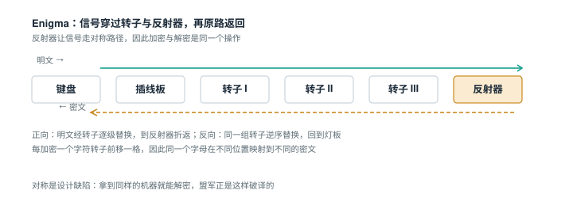

::: {.callout-note}
## Purpose (本章目标)

看清现代密码学其实只依赖两件东西：**难以求逆的单向函数**，和**足够好的随机性**。围绕这两点理解三个构件：模幂（RSA 的引擎）、素性测试（密钥生成的前提）、哈希链（Merkle 树的完整性）。最后用一个真实的死循环说明：把随机数当成可复现的常量，会让密码学代码直接失效。

> **English:** Modern cryptography rests on two things: one-way functions and good randomness. Build three primitives on that base — modular exponentiation, primality testing, hash chains — then watch a real infinite loop show what happens when randomness is treated as a reproducible constant.
:::

::: {.callout-tip}
## Projects in this chapter (本章项目与来源高校)

[009 Stanford](../universities/stanford.qmd) · [020 Cornell](../universities/cornell.qmd)
:::

## 单向函数：密码学的全部支点 / One-way functions carry everything

一个函数 `f` 如果正向计算很容易、反向求解很难，就叫单向函数。密码学的几乎所有构件都建立在某个候选单向函数上：

| 构件 | 依赖的困难问题 |
|---|---|
| RSA 加密 | 大整数分解 |
| Diffie-Hellman | 离散对数 |
| 数字签名 | 同上（或椭圆曲线版本） |
| 哈希链 | 抗碰撞性 |

"很难"不是修辞，而是计算复杂度意义上的：分解一个 2048 位整数，用目前最好的算法与硬件也需要远超宇宙年龄的时间。**整个体系的安全性不来自保密算法，而来自问题的难度**——这也是为什么算法可以公开。

## 模幂：把线性变成对数 / Exponentiation in log time

RSA 里所有的运算都是"模 n 的幂"。朴素做法要乘 `d` 次，而 `d` 通常是几百位——不可行。平方-乘（square-and-multiply）把复杂度降到 `O(log d)`：

```python
def mod_pow(base, exp, mod):
    result = 1
    base %= mod
    while exp:
        if exp & 1:              # 这一位是 1，乘进去
            result = result * base % mod
        base = base * base % mod # 平方，准备下一位
        exp >>= 1
    return result
```

原理是二进制展开：`a^13 = a^(1101₂) = a^8 · a^4 · a^1`。每一位只决定"乘不乘当前的平方"，所以循环次数等于指数的**位数**，而不是数值。

实测（009 的真实密钥）：

```text
[crypto] RSA n=2974515827 (p=47417, q=62731), e=65537
[crypto] encrypt(4242)=1080867353; decrypt -> 4242
```

`e = 65537 = 2^16 + 1`，二进制里只有两个 1——**这是刻意选的**：加密只需 17 次平方和 1 次乘法，比随机选一个大指数快得多，同时仍然安全。

## RSA：三个数字的关系 / Three numbers that must fit

密钥生成的三个量满足：

```text
n = p · q
φ(n) = (p − 1)(q − 1)
e · d ≡ 1  (mod φ(n))
```

实测的那组参数可以逐个验证（本书作者实际算过）：

| 量 | 值 | 关系 |
|---|---|---|
| p | 47417 | 素数 |
| q | 62731 | 素数 |
| n | 2974515827 | `p × q` ✓ |
| φ(n) | 2974405680 | `(p−1)(q−1)` |
| e | 65537 | 公开指数 |
| d | 72570833 | `e·d mod φ(n) = 1` ✓ |

正确性来自欧拉定理：若 `gcd(m, n) = 1`，则 `m^φ(n) ≡ 1 (mod n)`。因为 `ed = 1 + kφ(n)`，所以

```text
(m^e)^d = m^(1 + kφ(n)) = m · (m^φ(n))^k ≡ m · 1^k = m  (mod n)
```

**这就是"加密再解密得到原文"的全部理由。** 它不依赖任何实现技巧，只依赖一条数论恒等式——这也是为什么 RSA 能被证明正确，而大多数工程代码只能被测试。

安全性则来自另一件事：`n` 是公开的，但要从 `n` 反推 `p` 和 `q` 需要分解大整数。**知道 `n` 就能加密，知道 `p·q` 的分解才能解密**——这两件事的难度差距就是 RSA 的全部安全性。

## 签名：把密钥反过来用 / Signatures reverse the keys

加密用公钥 `(n, e)`，解密用私钥 `(n, d)`。签名把角色对调：

```text
签名：  s = H(m)^d mod n        （用私钥）
验证：  H(m) == s^e mod n       （用公钥）
```

任何人都能用公钥验证，但只有私钥持有者能生成。实测：

```text
[crypto] sign(4242) verified: True; tampered: False
```

第二项是关键：**篡改后的消息验证失败**。这不是"签名算法聪明"，而是哈希的性质——消息改一个字节，`H(m)` 完全不同，验证自然不通过。

实践中签名的是 `H(m)` 而不是 `m` 本身，原因有二：哈希把任意长度压成固定长度（RSA 一次只能处理小于 `n` 的数）；哈希的抗碰撞性保证"改消息不改哈希"不可行。

## Merkle 树：把完整性检查降到对数 / Integrity in log time

把一批数据分成叶子，两两哈希向上合并，最后得到一个根哈希：

```text
        root
       /    \
     h01    h23
     / \    / \
   h0  h1  h2  h3
```

要验证"第 2 块数据没有被篡改"，不需要下载全部数据——只需要 `h3` 和 `h01`（兄弟路径），重新算到根，与已知的根哈希比较。**验证代价是 `O(log n)` 次哈希，而不是 `O(n)`。**

实测：

```text
[crypto] merkle root = ea59a369466be42d1a4783f09ae0721a ...
[crypto] root changes on tamper: True
```

"根变了"就是全部安全性：任何一片叶子的改动都会沿着路径传播到根，而哈希的抗碰撞性保证这种变化不可能被"抵消"。

## Enigma：对称性来自一个反射器 / Symmetry from a reflector

Enigma 不是现代意义上的加密，但它的结构值得看：转子（rotor）做替换，反射器（reflector）把信号折回。

实测：

```text
[enigma] HELLO -> WSDUQ
[enigma] WSDUQ -> HELLO
[enigma] 'HI, WORLD! 123' -> 'WW, BGNGF! 123'
[enigma] consecutive 'A' -> Q, X (should differ)
```

四行输出各验证一件事：

1. **`HELLO → WSDUQ → HELLO`**：加解密是同一个操作。因为反射器让信号走一条对称路径，加密和解密在数学上是同一个函数。**这个性质是 Enigma 的致命弱点**：一台机器既能加密也能解密，意味着盟军只要造出同样的机器就能读报文。
2. **非字母字符不变**：`'HI, WORLD! 123'` 里只有字母被替换，标点与数字原样保留——这是机械结构的限制，不是设计选择。
3. **连续两个 `A` 得到 `Q` 和 `X`**：转子每加密一个字符就转动一格，所以同样的明文在不同位置映射到不同的密文。这是 Enigma 唯一的强度来源。

{#fig-enigma-path width=100%}

## 随机数：可复现与不可预测的冲突 / Reproducible versus unpredictable

开发中真实遇到的 bug：

> 固定随机种子后，两次 `gen_prime()` 返回同一个素数，`while p == q` 变成死循环，测试超时 180 秒。

这个 bug 有两层教训：

**表层**：测试里用固定种子是为了可复现，但密钥生成需要两个**不同**的素数。给两次调用不同的种子即可修复。

**深层**：**密码学意义上的随机性不是"看起来随机"，而是"不可预测"**。Python 的 `random` 模块是伪随机数生成器（PRNG），它的输出在知道种子后完全可预测——用它生成密钥等同于公开私钥。密钥材料必须来自 `secrets` 或操作系统的 CSPRNG。

这个区分在测试里制造了一个真实矛盾：**可复现性要求确定性，安全性要求不可预测**。工程上的解法是分开两种随机源——测试用固定种子验证逻辑，生产用 CSPRNG 生成密钥。

> **English:** A fixed seed made two prime generators agree, so `while p == q` never terminated. The deeper issue: reproducibility and unpredictability are opposite requirements, and key material must come from a CSPRNG.

## Fallacies and Pitfalls (常见误解)

::: {.callout-warning}
## Fallacy 1：固定种子总是好习惯

对单元测试是的；对密钥生成是灾难。`random` 是 PRNG，种子已知则输出完全可预测，用它生成密钥等于把私钥公开。判断标准是"这段随机数是否参与安全决策"。

> **English:** A seed makes tests reproducible and keys predictable. Decide by whether the value protects anything.
:::

::: {.callout-warning}
## Fallacy 2：加密安全就够了，签名不重要

加密只保证机密性，不保证完整性与来源。没有签名，攻击者可以篡改密文（导致解密出错）、可以伪造发送者。**机密性、完整性、认证是三件不同的事**，需要不同的构件。

> **English:** Encryption hides content; only signatures bind content to an author.
:::

::: {.callout-warning}
## Pitfall：自己发明加密方案

把"异或 + 位移 + 再异或"组合起来看起来复杂，但没有任何安全性证明。现代密码学的原则是**使用经过分析的标准化构件**（AES、RSA、Ed25519），自己只负责正确地组合它们。自创方案几乎总是在密钥管理或选择明文攻击上崩溃。

> **English:** Composition is not security; use analysed primitives and get the composition right.
:::

::: {.callout-warning}
## Pitfall：忘记 RSA 只能处理小于 n 的数

RSA 的数学定义在 `mod n` 下成立，所以明文必须小于 `n`。实际做法是混合加密：用 RSA 加密一个对称密钥，用对称算法加密数据。直接"用 RSA 加密文件"会失败或需要分块，而分块会引入新的安全问题。

> **English:** RSA operates mod n; real systems encrypt a symmetric key with it and the payload with that key.
:::

## Self-Check (自测题)

1. 平方-乘为什么是 `O(log d)`？如果指数是 65537，循环执行多少次？
2. RSA 为什么必须 `e·d ≡ 1 (mod φ(n))`？用欧拉定理说明。
3. 签名为什么签 `H(m)` 而不是 `m`？
4. Merkle 树验证一个叶子的代价是多少？为什么？
5. 为什么用 `random` 生成 RSA 密钥是危险的？该怎么改？

<details><summary>答案</summary>

1. 循环次数等于指数的二进制位数，每次迭代右移一位。`65537 = 2^16 + 1`，二进制是 17 位，因此循环 17 次。
2. 因为 `(m^e)^d = m^(ed) = m^(1 + kφ(n)) = m·(m^φ(n))^k ≡ m·1 = m (mod n)`，其中最后一步用欧拉定理 `m^φ(n) ≡ 1`。`ed ≡ 1 mod φ(n)` 正是让指数"绕回 1"的条件。
3. 两个原因：RSA 只能处理小于 `n` 的数，哈希把任意长度压成固定长度；哈希的抗碰撞性保证篡改消息必然改变哈希，从而使验证失败。
4. `O(log n)` 次哈希（`n` 为叶子数）。只需兄弟路径上的哈希值，从叶子逐层向上重算到根，与已知根比较。
5. `random` 是伪随机数生成器，种子一旦可知（或被猜到），输出完全可预测，等于私钥可被重建。应使用 `secrets` 模块或操作系统 CSPRNG（如 `/dev/urandom`）生成密钥材料。

</details>

## Summary (本章小结)

密码学建立在单向函数与随机性之上。模幂把指数运算从线性降到对数，RSA 的正确性来自欧拉定理，安全性来自大整数分解的困难。签名把密钥反过来用，靠哈希把任意消息压成可验证的定长摘要。Merkle 树用哈希链把完整性检查降到对数代价。Enigma 的对称性（加密即解密）是它的结构缺陷，而转子推进是它唯一的强度来源。最后，可复现性与不可预测性在密码学里是一对真实矛盾——测试用固定种子，密钥必须用 CSPRNG。

> **English:** One-way functions plus randomness. Log-time exponentiation, Euler's theorem for correctness, factoring for security. Signatures reverse the keys; hash chains cut integrity checks to log time. Reproducible and unpredictable are opposite requirements, and only one of them may touch key material.
