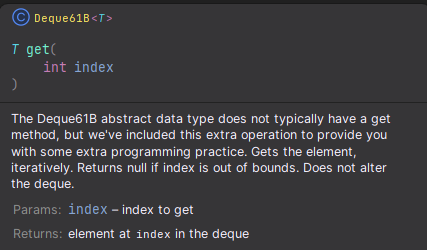
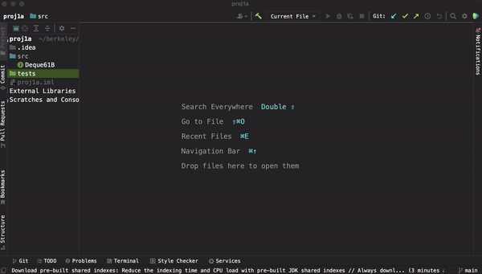
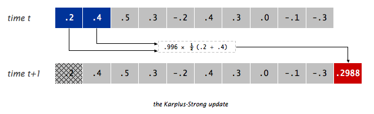

# 原始作业说明 / Original Assignment Handouts

> 提取自 UC Berkeley CS61B sp25 官方课程网站（题面不在 skeleton 仓库中，upstream 只含 starter 代码）：
> - proj1a: https://sp25.datastructur.es/projects/proj1a/
> - proj1b: https://sp25.datastructur.es/projects/proj1b/
>
> 正文为网页提取的官方题面原文；中文导读见 01-题目解读.md。
> Extracted from the official course website; the skeleton repo contains code only.

---

## Project 1A: LinkedListDeque61B（官方原文）

# Project 1A: LinkedListDeque61B

## Due: Monday, February 10 at 11:59 PM PT

## FAQ

Each assignment will have an FAQ linked at the top. You can also access it by
adding “/faq” to the end of the URL. The FAQ for Project 1A is located here .

## Introduction

In Project 0, you implemented game logic for 2048. In Project 1A and 1B (and some upcoming labs), you will implement
your own versions of data structures! In Project 1, you’ll begin by
building your own versions of the list-like structure: implementations of a new
abstract data type called a Double Ended Queue (deque, pronounced “deck”).

By the end of Project 1A, you will…

- Gain an understanding of the usage of a backing linked list in
data structures.

- Have experience with using testing and test-driven development to evaluate
the correctness of your own data structures.

For Project 1A, we will provide a significant amount of scaffolding by giving
explicit instructions. In Project 1B, you’ll be doing a similar task, but with
much less scaffolding.

This section assumes you have watched and fully digested the lectures up till
the DLList lecture, Lecture 5.

For this project, you must work alone! Please carefully read the Policy on Collaboration and Cheating to see what this means exactly. In particular, do not look for solutions online.

It should also go without saying that you may not use any of the built-in java.util data structures in your implementation! The whole point is to build
your own versions! There are a few places where you may use specific data
structures outside of tests, and we will clearly say where.

### Velocity Limiting

On this project, you will have a max of 4 submission tokens to the autograder, each with a refresh rate of 24 hours. Unlike previous assignments, not all tests will be provided locally , so it is up to you to write tests to verify the correctness of your own code. See the Writing Tests section for more details.

We will not grant extensions for failing to understand the token limiting policy. If you have questions, please ask!

### Style

On this project, we will be enforcing style . You must follow the style guide , or you will be penalized on the
autograder.

You can and should check your style locally with the CS 61B plugin. We will
not remove the velocity limit for failing to check style.

We will not be enforcing style for tests so you can use magic numbers!

### Getting the Skeleton Files

Follow the instructions in the Assignment Workflow guide to get the skeleton code and open it in IntelliJ. For this project, we will be
working in the proj1a directory.

You see a proj1a directory appear in your repo with the following structure:

```
 proj1a
├── src
│   └── Deque61B.java
└── tests
    ├── LinkedListDeque61BTest.java
    └── PreconditionTest.java

```

If you get some sort of error, STOP and either figure it out by carefully
reading the git WTFs or seek help at OH
or Ed. You’ll potentially save yourself a lot of trouble vs. guess-and-check
with git commands. If you find yourself trying to use commands recommended by
Google like force push , don’t . Don’t use force push, even if a post you found on Stack Overflow says to do it!

You can also watch Professor Hug’s demo about how to get started and this video if you encounter some git issues.

## Deque61B: ADT and API

The double ended queue is very similar to the SLList and AList classes that
we’ve discussed in class. Here is a definition from the Java standard library .

A linear collection that supports element insertion and removal at both ends.
The name deque is short for “double ended queue” and is usually pronounced
“deck”. Most Deque implementations place no fixed limits on the number of
elements they may contain, but this interface supports capacity-restricted
deques as well as those with no fixed size limit.

We don’t need all the methods defined in Java’s Deque , and have defined
our own interface, which can be found in src/Deque61B.java .

For example, the get method is described as follows, in something called a Javadoc comment :

```
/** ...
 * @param index index to get
 * @return element at {@code index} in the deque
 */
T get(int index);

```

Here, @param indicates a parameter to the method, and @return indicates the return value of the method. The @code tag is used to format as code.

If you hover over the method name in IntelliJ, you’ll see a popup that looks like this, which is useful if you want to know what a method does:



Begin by opening the Deque61B.java file and reading the
documentation in it. We will not repeat information that is in the
interface file in the specification – so, it is on you to make sure that you
are reading it as you complete the project.

You should not edit Deque61B.java .

It is on you to read the descriptions of the other methods.

Seriously. Do not skip this. You will spend hours confused if you skip this
step. Please save yourself the time and stress!

## LinkedListDeque61B

### Assignment Philosophy

A common beginner mistake is to write a large amount of code and hope that it
all works once you’re finished. This makes life very difficult for a
programmer. Imagine implementing all the methods above, submitting to the
autograder, and getting back a message that says something like “call to get returned 9, expected 7”. You have no idea if the problem is the get method
itself, or if some other necessary methods are broken.

To help encourage better programming habits, in Project 1A, we’re going to hold
your hands through the development process. You are not strictly required to
follow the recommended steps, i.e. if you pass the autograder, then you get all
the points, but we strongly encourage you to follow the steps outlined in
this spec.

For the intended experience, follow these steps in order. If you do something
else and ask us for help, we will refer you back to these steps.

### Creating the File

Start by creating a file called LinkedListDeque61B . This file should be created
in the proj1a/src directory. To do this, right-click on the src directory,
navigate to “New -> Java Class”, and give it the name LinkedListDeque61B .

We want our LinkedListDeque61B to be able to hold several different types. For
example, a LinkedListDeque61B<String> holds String s and a LinkedListDeque61B<Integer> holds Integer s. To enable this, you should
edit the declaration of your class so that it reads:

```
public class LinkedListDeque61B<T>

```

Recall from lecture that it doesn’t actually matter if we use T or some other
string like LinkedListDeque61B<Glerp> . However, we recommend using <T> for
consistency with other Java code.

We also want to tell Java that every LinkedListDeque61B is a Deque61B , so that
users can write code like Deque61B<String> lld1 = new LinkedListDeque61B<>(); .
To enable this, change the declaration of your class so that it reads:

```
public class LinkedListDeque61B<T> implements Deque61B<T>

```

However, this creates an error. In order for a LinkedListDeque61B to be a Deque61B , it needs to implement all the Deque61B methods. However your mouse over
the red squiggle, and click the “implement methods” button when the error
message box pops up. This will autogenerate the method headers for you.

The below GIF goes through these steps:



Lastly, you should create an empty constructor. To do this, add the following
code to your file, leaving the constructor blank for now.

```
public LinkedListDeque61B() {
}

```

Note: You can also generate the constructor by clicking “Code”, then “Generate”
then “Constructor”, though we prefer the typing-the-code-manually approach.

Now you’re ready to get started!

### JUnit Tests

#### LinkedListDeque61BTest

Now open the LinkedListDeque61BTest.java file. You’ll see that every line has a // preceding it. Let’s remove all of the // comments except last line. To do
this, highlight all the lines of the file that start with // . Then click
“Code” in the top menu bar, then “Comment with Line Comment”. All the lines
should now be uncommented. You can also use Ctrl+/ (Windows / Linux) or ⌘ / / Cmd+/ (Mac).

Now click and run all the tests. You should fail nearly all the tests since
you haven’t implemented any methods yet.

Before you can pass these tests, there’s a lot of work you’ll need to do, so
we’re going to set aside the tests for now and come back to them much later.

#### PreconditionTest

In this test file, we’ve provided a few tests that check that your LinkedListDeque61B file to check your code structure for correctness. You do not need to understand these tests, but you should be able to run them.

### Writing and Verifying the Constructor

This section assumes you have watched and fully digested the lectures up to and including the DLList lecture, Lecture 5.

A “topology” is a structure that you can use to represent the linked list. Though there are numerous choices as discussed in lecture, for this project, you are required to implement a circular, doubly-linked topology with a sentinel:

The empty list is represented by a single sentinel
  node that points at itself. There is a single instance variable called sentinel that points at this sentinel. See this slide.

As mentioned in lecture, though this last approach seems the most complicated
at first, it will ultimately lead to the simplest implementation.

Implement the constructor for LinkedListDeque61B to match the appropriate topology.

Along the way you’ll need to create a Node class and introduce one or more
instance variables. This may take you some time to understand fully.

Your nodes should be doubly-linked, and have exactly the
necessary fields (instance variables) for a doubly-linked node. Additionally, you should only have
one node class, and this node class must be an inner, or nested class
inside LinkedListDeque61B .

The design of your Node class is a strict requirement . If your Node class
does not meet the specfication listed above (nested class, with the fields of a
doubly linked node) you will not pass the autograder.

When you’re done, set a breakpoint on the first line of addFirstTestBasic .
Run the test in debug mode, and use
the Step Over ( ) feature. Use the
Java Visualizer to verify that your created object matches the expected topology.


Task : Implement the constructor. Your LinkedListDeque61B` constructor must take 0 arguments. Implement a node class. (You would 
also probably need some instance variables.)

If PreconditionTest fails, your implementation is insufficient in
some way. The test should give you a hint as to what is wrong. Some common mistakes:

- You may be using an incorrect topology. (If you run into a NullPointerException , this is likely the case.)

- Node might be defined in a separate file.

- Node might be using an incorrect type to store data. Remember that Deque61B is generic .

- LinkedListDeque61B might have a constructor that takes additional arguments.

- It might have too few or too many fields (instance variables) for a doubly-linked node.

- It might have non-primitive or non-node fields.

The other tests may not work until you complete toList .

### Writing and Verifying addFirst and addLast

addFirst and addLast may not use looping or recursion. A single add
operation must take "constant time," that is, adding an element should take
approximately the same amount of time no matter how large the deque is. This
means that you cannot use loops that iterate through all / most elements of the deque.

Fill in the addFirst and addLast methods. Then, debug addFirstAndAddLastTest . This test will not pass because you haven’t written toList yet, but you can use the debugger and visualizer to verify that
your code is working correctly.

Task : Implement addFirst and addLast , and verify that they are correct
using addFirstAndAddLastTest and the Java visualizer.

The tests will not work until you complete the next section, toList .

### Writing and Verifying toList

You may have found it somewhat tedious and unpleasant to use the debugger and
visualizer to verify the correctness of your addFirst and addLast methods.
There is also the problem that such manual verification becomes stale as soon
as you change your code. Imagine that you made some minor but uncertain change
to addLast . To verify that you didn’t break anything you’d have to go back
and do that whole process again. Yuck.

(Also, we have just under 1500 students! No way we’re doing that to grade
everyone’s work.)

What we really want are some automated tests. But unfortunately there’s no easy
way to verify correctness of addFirst and addLast if those are the only two
methods we’ve implemented. That is, there’s currently no way to iterate over
our list and get back its values and see that they are correct.

That’s where the toList method comes in. When called, this method returns a List representation of the Deque61B . For example, if the Deque61B has had addLast(5) , addLast(9) , addLast(10) , then addFirst(3) called on it,
then the result of toList() should be a List with 3 at the front, then 5,
then 9, then 10. If printed in Java, it’d show up as [3, 5, 9, 10] .

Write the toList method. The first line of the method should be something
like List<T> returnList = new ArrayList<>() . This is one location where you
are allowed to use a Java data structure. You can import ArrayList by using IntelliJ’s auto import or copying this statement:

```
import java.util.ArrayList; // import the ArrayList class

```

To verify that your toList method is working correctly, you can run the tests
in LinkedListDeque61BTest . If you pass all the tests, you’ve established a firm
foundation upon which to continue working on the project. Woo! If not, use the
debugger and carefully investigate to see what’s wrong with your toList method. If you get really stuck, go back and verify that your addFirst and addLast methods are working.

Some later methods might seem easy if you use toList . You may not call toList inside LinkedListDeque61B ; there is a test that
checks for this.

Task : Implement toList , and verify that it is correct with the tests
in LinkedListDeque61BTest .

### The Testing Component

In Project 0, we gave you a full suite of unit tests that you could use to test
your code locally. In this project, you’ll be required to write your own unit
test suite that provides similar coverage. To give a bit of insight about how
this works, we will essentially be taking your test file
( LinkedListDeque61BTest.java ) and using it to “test” our staff solution of LinkedListDeque61B . Using some autograder magic, we’re able to determine which
edge cases your tests are able to hit, thus telling us the “coverage” of your
test suite. So, in order to get a full score on this component, you should try to
think of any and all corner cases for each of the methods!

Our staff solution also
only has a constructor that takes 0 arguments, which means that your tests
should only use a constructor that takes 0 arguments.

Sharing tests are considered academic misconduct and cheating .
Please don’t. This is for you to develop testing skills.

### Writing Tests

To write tests, we will use Google’s Truth assertions
library. We use this library over JUnit assertions for the following reasons:

- Better failure messages for lists.

- Easier to read and write tests.

- Larger assertions library out of the box.

We often write tests using the Arrange-Act-Assert pattern:

- Arrange the test case, such as instantiating the data structure or
filling it with elements.

- Act by performing the behavior you want to test.

- Assert the result of the action in (2).

We will often have multiple “act” and “assert” steps in a single test method
to reduce the amount of boilerplate (repeated) code.

You should write your tests in LinkedListDeque61BTest.java .

Note : The tests that you write in this project will be checked for the
different "scenarios" they cover. You will need to cover sufficiently many
scenarios, including a few edge cases.

Passing the coverage checker does not mean that your tests are perfect ! There might still be edge cases that you are missing, as we do not require 100% coverage, and we cannot possibly test every single case. We recommend that you write your own tests to check your code in cases that fail, and not just rely on the coverage checker.

While the coverage checker can check how much you do to the
deque, it doesn’t check what you assert about the deque. If you find yourself
failing autograder tests that you think you have coverage for, a good next step
is to add additional assertions to your own tests. Examples include verifying
the result of every call, checking the entire deque between every call, or
checking the results of other deque methods.

#### Truth Assertions

A Truth assertion takes the following format:

```
assertThat(actual).isEqualTo(expected);

```

To add a message to the assertion, we can instead use:

```
assertWithMessage("actual is not expected")
    .that(actual)
    .isEqualTo(expected);

```

We can use things other than isEqualTo , depending on the type of actual .
For example, if actual is a List , we could do the following to check its
contents without constructing a new List :

```
assertThat(actualList)
    .containsExactly(0, 1, 2, 3)
    .inOrder();

```

If we had a List or other reference object, we could use:

```
assertThat(actualList)
    .containsExactlyElementsIn(expected)  // `expected` is a List
    .inOrder();

```

Truth has many assertions, including isNull and isNotNull ; and isTrue and isFalse for boolean s. IntelliJ’s autocomplete will often give
you suggestions for which assertion you can use.

If you do not assert anything, you will pass your own tests, even if your implementation is incorrect! For example, the following test will pass, even if addFirst does nothing:

```
@Test
public void noAssertionTest() {
    Deque61B<String> lld = new LinkedListDeque61B<>();
    lld.addFirst("front");
}

```

You also must remember to use .isTrue() or .isFalse() when asserting boolean statements. For example, the following test will always pass, even if isEmpty always returns false !

```
@Test
public void isEmptyTest() {
    Deque61B<String> lld = new LinkedListDeque61B<>();
    assertThat(lld.isEmpty());
}

```

The last line of the above test should instead be assertThat(lld.isEmpty()).isTrue(); .

#### Example Test

Let’s break down the provided addLastTestBasic :

```
@Test
/** In this test, we use only one assertThat statement.
    *  Sometimes, the tedious work of adding the extra assertion statements isn't worth it. */
public void addLastTestBasic() {
    Deque61B<String> lld1 = new LinkedListDeque61B<>();

    lld1.addLast("front"); // after this call we expect: ["front"]
    lld1.addLast("middle"); // after this call we expect: ["front", "middle"]
    lld1.addLast("back"); // after this call we expect: ["front", "middle", "back"]
    assertThat(lld1.toList()).containsExactly("front", "middle", "back").inOrder();
}

```

- @Test tells Java that this is method is a test , and should be run when
we run tests.

- Arrange : We construct a new Deque61B , and add 3 elements to it using addLast .

- Act : We call toList on Deque61B . This implicitly depends on the
earlier addLast calls.

- Assert : We use a Truth assertion to check that the toList contains
specific elements in a specific order.

### The Remaining Methods

Now you should test and implement all the remaining methods. For the
rest of this project, we’ll describe our suggested steps at a high level. We strongly encourage you to follow the remaining steps in the order given.
In particular, write tests before you implement. This is called
“test-driven development,” and helps ensure that you know what your methods are
supposed to do before you do them.

#### isEmpty and size

These two methods must take constant time . That is, the time it takes to for
either method to finish execution should not depend on how many elements are in
the deque.

Write one or more tests for isEmpty and size . Run them and verify that they
fail. Your test(s) should verify more than one interesting case, such as
checking both an empty and a nonempty list, or checking that the size changes.

For these tests, you can use the isTrue or isFalse methods on your assertThat statements.

Your tests can range from very fine-grained, e.g. testIsEmpty , testSizeZero , testSizeOne to very coarse grained, e.g. testSizeAndIsEmpty . It’s up to you
to explore and find what granularity you prefer.

Task : Write tests for the isEmpty and size methods, and check that
they fail. Then, implement the methods.

#### get

Write a test for the get method. Make sure to test the cases where get receives an invalid argument, e.g. get(28723) when the Deque61B only has 1
item, or a negative index. In these cases get should return null .

get must use iteration.

Task : After you’ve written tests and verified that they fail , implement get .

#### getRecursive

Since we’re working with a linked list, it is interesting to write a recursive
get method, getRecursive .

Copy and paste your tests for the get method so that they are the same except
they call getRecursive . (While there is a way to avoid having copy and pasted
tests, though the syntax is not worth introducing – passing around functions
in Java is a bit messy.)

Task : After you’ve copy-pasted tests and verified that they fail ,
implement getRecursive .

#### removeFirst and removeLast

Lastly, write some tests that test the behavior of removeFirst and removeLast , and again ensure that the tests fail. For these tests you’ll
want to use toList ! Use addFirstAndAddLastTest as a guide.

Do not maintain references to items that are no longer in the deque. The amount
of memory that your program uses at any given time must be proportional to the
number of items. For example, if you add 10,000 items to the deque, and then
remove 9,999 items, the resulting memory usage should amount to a deque with 1
item, and not 10,000. Remember that the Java garbage collector will “delete”
things for us if and only if there are no pointers to that object.

If Deque61B is empty, removing should return null .

removeFirst and removeLast may not use looping or recursion. Like addFirst and addLast ,
these operations must take "constant time." Refer to the section on writing addFirst and addLast for more information on what this means.

Task : After you’ve written tests and verified that they fail , implement removeFirst and removeLast .

### Submit to the Autograder

Once you’ve written local tests and passed them, try submitting to the
autograder. You may or may not pass everything.

- If you fail any of the coverage tests, it means that there is a case that
your local tests did not cover. Here is a list of test cases that you should cover.

- If you fail any of the timing tests, it means that your implementation does
not meet the timing constraints described above.

- You will have a token limit of 4 tokens every 24 hours. We will not reinstate tokens for failing to add/commit/push your code, run style, etc.

- Scoring

This project, similar to Project 0, is divided into individual components, each
of which you must implement completely correctly to receive credit.

- Empty list (15%) : Define a valid Node class and correctly implement
 the constructor.

- Adding (25%) : Correctly implement addFirst , addLast , and toList .

- isEmpty , size (5%) : Correctly implement isEmpty and size with
 add methods working.

- get (5%) : Correctly implement get .

- getRecursive (5%) : Correctly implement getRecursive .

- Removing (25%) : Correctly implement removeFirst and removeLast .

- Integration (10%) : Pass an integration test suite that randomly calls all the methods.

- Test Coverage (10%) : Write tests to capture a sufficient number of flags.

For the test coverage component, we will run your
tests against a staff solution and check how many scenarios and edge cases are
tested. You can receive partial credit for this component. You can find the list of scenarios here .

### Credits

- Ring buffer figures from Wikipedia .

- This assignment adapted from Kevin Wayne’s Guitar Heroine assignment.

---

## Project 1B: ArrayDeque61B（官方原文）

# Project 1B: ArrayDeque61B

## Due: Wednesday, February 19th, 11:59 PM PT

## FAQ

Each assignment will have an FAQ linked at the top. You can also access it by adding “/faq” to the end of the URL. The
FAQ for Project 1B is located here .

Note that this project has limited submission tokens. Please see Submit to the Autograder for more details.

## Introduction

In Project 1A, we built LinkedListDeque61B . Now we’ll see a different
implementation of the Deque61B interface that uses a backing array , rather
than linked nodes.

By the end of Project 1B, you will…

- Gain an understanding of the implementation of a backing array in
data structures.

- Have more experience using testing and test-driven development to verify
the correctness of these data structures.

Check out the Project 1B slides for some additional visually oriented tips.

Check out the Getting Started Video for an overview of this project.

We will provide relatively little scaffolding. In other words, we’ll say what
you should do, but not how.

This section assumes you have watched and fully digested the lectures up till
the ArrayList lecture, Lecture 7.

For this project, you must work alone! Please carefully read the Policy on Collaboration and Cheating to see what this means exactly. In particular, do not look for solutions online.

It should (still) go without saying that you may not use any of the built-in java.util data structures in your implementation! The whole point is to build
your own versions! There are a few places where you may use specific data
structures outside of tests, and we will clearly say where.

### Style

As in Project 1A, we will be enforcing style . You must follow the style guide , or you will be penalized on the
autograder. Note that style penalties do not apply to test files.

You can and should check your style locally with the CS 61B plugin. We will
not remove the velocity limit for failing to check style.

### Getting the Skeleton Files

Follow the instructions in the Assignment Workflow guide to get the skeleton code and open it in IntelliJ. For this project, we will be
working in the proj1b directory.

You see a proj1b directory appear in your repo with the following structure:

```
 proj1b
├── src
│   └── deque
│       ├── Deque61B.java
│       └── Maximizer61B.java
└── tests
    ├── ArrayDeque61BPreconditionTest.java
    ├── ArrayDeque61BTest.java
    └── Maximizer61BTest.java

```

Note that you’ll also see a gh2 directory and the related test file TestGuitarString.java . 
These are related to an optional Guitar Hero section, which you can read about further down.

If you get some sort of error, STOP and either figure it out by carefully
reading the Git WTFs or seek help at OH
or Ed. You’ll potentially save yourself a lot of trouble vs. guess-and-check
with git commands. If you find yourself trying to use commands recommended by
Google like force push , don’t . Don’t use force push, even if a post you found on Stack Overflow says to do it!

You can also watch Professor Hug’s demo about how to get started and this video if you encounter some git issues.

## Deque: ADT and API

If you need a refresher on Deque61B s, refer to the Project 1A spec and the Deque61B.java file.

## Creating the File

Start by creating a file called ArrayDeque61B . This file should be created
in the proj1b/src/deque directory. To do this, right-click on the deque directory,
navigate to “New -> Java Class”, and give it the name ArrayDeque61B .

Just like you did in Project 1A We want our ArrayDeque61B to be able to hold several different types. To enable this, you should edit the declaration of your class so that it reads:

```
public class ArrayDeque61B<T>

```

Recall from lecture that it doesn’t actually matter if we use T or some other
string like ArrayDeque61B<Glerp> . However, we recommend using <T> for
consistency with other Java code.

We also want to tell Java that every ArrayDeque61B is a Deque61B , so that users can write code like Deque61B<String> lld1 = new ArrayDeque61B<>(); . To enable this, change the declaration of your class so that it reads:

```
public class ArrayDeque61B<T> implements Deque61B<T>

```

Once you’ve done this step, you’ll likely see a squiggly red line under the
entire class declaration. This is because you said that your class implements
an interface, but you haven’t actually implemented any of the interface methods
yet.

Hover over the red line with your mouse, and when the
IntelliJ pop-up appears, click the “Implement methods” button. Ensure that all the
methods in the list are highlighted, and click “OK”. Now, your class should
be filled with a bunch of empty method declarations. These are the methods that you’ll
need to implement for this project!

Lastly, you should create an empty constructor. To do this, add the following
code to your file, leaving the constructor blank for now.

```
public ArrayDeque61B() {
}

```

Note: You can also generate the constructor by clicking “Code”, then “Generate”
then “Constructor”, though I prefer the typing the code yourself approach.

Now you’re ready to get started!

## ArrayDeque61B

As your second deque implementation, you’ll build the ArrayDeque61B class. This
deque must use a Java array as the backing data structure.

You may add any private helper classes or methods in ArrayDeque61B.java if you
deem it necessary.

### Constructor

You will need to somehow keep track of what array indices hold the deque’s
front and back elements. We strongly recommend that you treat your array as
circular for this exercise. In other words, if your front item is at position 0 , and you addFirst , the new front should loop back around to the end of
the array (so the new front item in the deque will be the last item in the
underlying array). This will result in far fewer headaches than non-circular
approaches.

See the Project 1B demo slides for more details. In particular, note that
while the conceptual deque and the array contain the same elements, they do not
contain them in the same order.

We recommend using the floorMod(int a, int b) method from Java’s built-in Math class to assist you in 
designing a circular approach. Whereas a % b might return negative numbers when a is negative, floorMod(int a, int b) always return non-negative numbers. In practice, this means that the output will have the same sign as the divisor. Here are a few examples
using the floorMod(int a, int b) method:

```
    int value1 = Math.floorMod(16, 16); // value1 == 0
    int value2 = Math.floorMod(-1, 16); // value2 == 15
    int value3 = Math.floorMod(20, 16); // value3 == 4

```

You can use the floorMod(int a, int b) method by adding the following import statement to the top of your file: import java.lang.Math; .

You cannot create an array of generics (e.g. new T[1000] ) in Java for reasons beyond the scope of this course . You will instead need to use the syntax (T[]) new Object[1000] .

Declare the necessary instance variables, and implement the constructor.

The starting size of your backing array must be 8 .

### addFirst and addLast

As before, implement addFirst and addLast . These two methods must not use looping or recursion. A single add operation must take “constant time,”
that is, adding an element should take approximately the same amount of time no
matter how large the deque is (with one exception). This means that you cannot
use loops that iterate through all / most elements of the deque.

### get

Unlike in LinkedListDeque61B , this method must take constant time .

As before, get should return null when the index is invalid (too large or
negative). You should disregard the skeleton code comments for Deque61B.java for this case.

After you’ve written tests and verified that they fail , implement get .

### isEmpty and size

These two methods must take constant time . That is, the time it takes to for
either method to finish execution should not depend on how many elements are in
the deque.

Write tests for the isEmpty and size methods, and check that
they fail. Then, implement the methods.

### toList

toList will continue to be useful to test your Deque61B .

Write the toList method. The first line of the method should be something
like List<T> returnList = new ArrayList<>() . This is one location where you
are allowed to use a Java data structure.

Some later methods might seem easy if you use toList . You may not call toList inside ArrayDeque61B ; there is a test that
checks for this.

Hint One of the other methods may be helpful for implementing this method.

Implement toList . You are not given tests this time, so you will
need to write them!

All that’s left is to test and implement all the remaining methods. For the
rest of this project, we’ll describe our suggested steps at a high level. We strongly encourage you to follow the remaining steps in the order given.
In particular, write tests before you implement the method’s functionality. This is called “test-driven development,” and helps ensure that you know what
your methods are supposed to do before you do them.

### removeFirst and removeLast

Lastly, write some tests that test the behavior of removeFirst and removeLast , and again ensure that the tests fail.

Do not maintain references to items that are no longer in the deque.

removeFirst and removeLast may not use looping or recursion. Like addFirst and addLast ,
these operations must take "constant time." Refer to the section on writing addFirst and addLast for more information on what this means.

### getRecursive

Although we are not using a linked list anymore for this project, it is still required to implement this method to keep consistent with our interface.
This method technically shouldn’t be in the interface, but it’s here to make testing nice. You can just use this code block for it:

```
    @Override
    public T getRecursive(int index) {
        throw new UnsupportedOperationException("No need to implement getRecursive for proj 1b");
    }

```

“Implement” getRecursive .

### Resizing

We recommend you complete the other methods first, verify that they are working correctly without resizing, and come back to resizing after.

#### Resizing Up

The exception to an Array Deque’s “constant time” requirement is when the array fills, and
you need to “resize” to have enough space to add the next element. In this case, you
can take “linear time” to resize the array before adding the element.

Correctly resizing your array is very tricky, and will require some deep
thought. Try drawing out various approaches by hand. It may take you quite some
time to come up with the right approach, and we encourage you to debate the big
ideas with your fellow students or TAs. Make sure that your actual
implementation is by you alone .

Make sure to resize by a geometric factor.

We do not recommend using arraycopy with a circular implementation. It
will work, but results in a significantly more complex (and harder to debug!)
implementation than necessary.

Instead, we suggest thinking forward to how you might implement get and using
a for loop in some way.

Remember to implement addFirst and addLast first, and write tests to verify that
they are correct. Make sure to add enough elements so that
your backing array resizes! For more info on resizing, check out these slides .

#### Resizing Down

The amount of memory that your program uses at any given time must be
proportional to the number of items. For example, if you add 10,000 items to
the deque, and then remove 9,999 items, you shouldn’t still be using an array
that can hold 10,000 items. For arrays of length 16 or more, your usage factor
should always be at least 25%. This means that before performing a remove
operation, if the number of elements in the array is at or under 25% the
length of the array, you should resize the array down. For arrays
length 15 or less, your usage factor can be arbitrarily low.

We, again, do not recommend using arraycopy with a circular
implementation. If you followed our advice above to use a for loop to resize
up, resizing down should look very similar to resizing up (perhaps a helper
method?).

After you’ve written tests and verified that they fail , implement removeFirst and removeLast .

For the intended experience, follow these steps in order. If you do something
else and ask us for help, we will refer you back to these steps.

### Writing Tests

Refer to the Project 1A spec for
a review of how to write tests. Similar to Project 1A, you will be scored on
the coverage of your unit tests for Project 1B. You might find some of your
tests from Project 1A to be reusable in this project; don’t be afraid to
copy them over!

Note that you should only be using variables and methods found in the Deque interface when writing your coverage tests. This is because we run our “own”
Deque implementations against your tests to determine if they have 
enough coverage.

You can test your coverage by submitting to the [UNGRADED] Project 1B: 
ArrayDeque Test Coverage assignment, which will not be graded and has no
velocity limit. Your final test coverage grade component will be determined 
from your submission to the main Project 1B: ArrayDeque assignment.

### Suggestions

- Try to get everything working for a fixed-size array first. This would be good point to start to familiarize yourself.

- Once you are confident working solution for a fixed-size array, try resizing - consider having a helper method for it!

- DO NOT modify Deque61B interface.

- When in doubt, draw it out! We suggest drawing box-and-pointer diagrams (or diagrams in general) when faced with issues in your methods, it will help you understand both your code as well as the intended logic better.

## Deque61B Enhancements

In this section of the project, you are going to expand upon the functionality of the Deque61B interface.

### Object Methods

In order to implement the following methods, you should start by copying and pasting your Project 1A
implementation of LinkedListDeque61B into the src directory.

#### iterator()

One shortcoming of our Deque61B interface is that it can not be iterated over. That is, the code below fails to compile with the error “foreach not applicable to type”.

```
  Deque61B<String> lld1 = new LinkedListDeque61B<>();

  lld1.addLast("front");
  lld1.addLast("middle");
  lld1.addLast("back");
  for (String s : lld1) {
      System.out.println(s);
  }

```

Similarly, if we try to write a test that our Deque61B contains a specific set of items, we’ll also get a compile error, in this case: “Cannot resolve method containsExactly in Subject”.

```
public void addLastTestBasicWithoutToList() {
    Deque61B<String> lld1 = new LinkedListDeque61B<>();

    lld1.addLast("front"); // after this call we expect: ["front"]
    lld1.addLast("middle"); // after this call we expect: ["front", "middle"]
    lld1.addLast("back"); // after this call we expect: ["front", "middle", "back"]
    assertThat(lld1).containsExactly("front", "middle", "back");
}

```

Again the issue is that our item cannot be iterated over. The Truth library works by iterating over our object (as in the first example), but our LinkedListDeque61B does not support iteration.

To fix this, you should first modify the Deque61B interface so that the declaration reads:

```
public interface Deque61B<T> extends Iterable<T> {

```

Next, implement the iterator() method using the techniques described in lecture 10.

Task : Implement the iterator() method in both LinkedListDeque61B and ArrayDeque61B according to lecture.

You are not allowed to call toList here.

#### equals()

Consider the following code:

```
    @Test
    public void testEqualDeques61B() {
        Deque61B<String> lld1 = new LinkedListDeque61B<>();
        Deque61B<String> lld2 = new LinkedListDeque61B<>();

        lld1.addLast("front");
        lld1.addLast("middle");
        lld1.addLast("back");

        lld2.addLast("front");
        lld2.addLast("middle");
        lld2.addLast("back");

        assertThat(lld1).isEqualTo(lld2);
    }

```

If we run this code, we see that we fail the test, with the following message:

```
expected: [front, middle, back]
but was : (non-equal instance of same class with same string representation)

```

The issue is that the Truth library is using the equals method of the LinkedListDeque61B class. The default implementation is given by the code below :

```
    public boolean equals(Object obj) {
        return (this == obj);
    }

```

That is, the equals method simply checks to see if the addresses of the two objects are the same. We want to be able to check whether the two Deque61B objects are equal in terms of elements and order so therefore we need a different equals method.

Override the equals method in the ArrayDeque61B and LinkedListDeque61B classes. For guidance on writing an equals method, see the lecture slides or the lecture code repository .

Note: You might ask why we’re implementing the same method in two classes rather than providing a default method in
the Deque61B interface. Interfaces are not allowed to provide default methods that override Object methods. For more
see https://stackoverflow.com/questions/24595266/why-is-it-not-allowed-add-tostring-to-interface-as-default-method .

However, one workaround for this is to provide a default , non- Object helper method in the Deque61B interface and have the implementing classes call it.

Override the equals() method in the LinkedListDeque61B and ArrayDeque61B classes.

Important: You should not use getClass , and there’s no need to do any casting in your equals method. That is, you shouldn’t be doing (ArrayDeque61B) o . Such equals methods are old fashioned and overly complex. Use instanceof instead.

Note: The instanceof operator behaves a little strangely with generic types, for reasons beyond the scope of this course. For example, if you want to check if lst is an instance of a List<Integer> , you should use lst instanceof List<?> rather than lst instanceof List<Integer> . Unfortunately, this is not able to check the types of the elements, but it’s the best we can do.

Important: Make sure you use the @Override tag when overriding methods. A common mistake in student code is to try to override equals(ArrayList<T> other) rather than equals(Object other) . Using the optional @Override tag will prevent your code from compiling if you make this mistake. @Override is  a great safety net.

You are not allowed to call toList here.

#### toString()

Consider the code below, which prints out a LinkedListDeque61B .

```
Deque61B<String> lld1 = new LinkedListDeque61B<>();

lld1.addLast("front");
lld1.addLast("middle");
lld1.addLast("back");

System.out.println(lld1);

```

This code outputs something like deque.proj1a.LinkedListDeque61B@1a04f701 . This is because the print statement implicitly calls the LinkedListDeque61B toString method. Since you didn’t override this method, it uses the default, which is given by the code below (you don’t need to understand how this code works).

```
    public String toString() {
        return getClass().getName() + "@" + Integer.toHexString(hashCode());
    }

```

In turn the hashCode method, which you have also not overridden, simply returns the address of the object, which in the example above was 1a04f701 .

Task : Override the toString() method in the LinkedListDeque61B and ArrayDeque61B classes, such that the code above prints out [front, middle, back] .

Hint: Java’s implementation of the List interface has a toString method.

Hint: There is a one line solution (see hint 1).

Hint: Your implementation for LinkedListDeque61B and ArrayDeque61B should be exactly the same.

#### Testing The Object Methods

We haven’t provided you with test files for these three object methods; however, we strongly encourage you to use the
techniques you have learned so far to write your own tests. You can structure these tests however you’d like,
since we won’t be testing them. One possible (and suggested) structure is to create a new file in the tests directory
called LinkedListDeque61BTest so that you have a testing file for each implementation.

## Maximizer61B

This section requires information covered in Lecture 9: Subtype Polymorphism, Comparators and Lecture 10: Iterators, Object Methods.

For the final part of this project you will build the Maximizer61B class. This class is independent of the part where you wrote ArrayDeque61B .

This part of the project is admittedly disconnected from the previous parts, but we wanted to get you some practice with Iterables, Comparables, and Comparators.

The Maximizer61B class has two static methods:

- public static <T extends Comparable<T>> T max(Iterable<T> iterable) : returns the maximum element in the given iterable.

- public static <T> T max(Iterable<T> iterable, Comparator<T> comp) : returns the maximum element in the given iterable according to the specified comparator.

If the iterable is empty, simply return null .

## Guitar Hero (Optional)

Now that you have created a deque, let’s use it for something interesting! In this part of the project, we will create another package for generating synthesized musical instruments using
the deque package we just made. We’ll get the opportunity to use our data structure for implementing an algorithm that
allows us to simulate the plucking of a guitar string.

### The GH2 Package

The gh2 package has just one primary component that you will edit:

- GuitarString , a class which uses a Deque61B<Double> to implement the Karplus-Strong algorithm to synthesize a guitar string sound.

We’ve provided you with skeleton code for GuitarString which is where you will use your deque package that you made
in the first part of this project.

We want to finish the GuitarString file, which should use the deque package to replicate the sound of a plucked
string. Note that this file uses the word “buffer”, which is a synonym for “deque” in this context.

We’ll be using the Karplus-Strong algorithm, which is quite easy to implement with a Deque61B . It is simply the following three steps:

- Replace every item in a Deque61B with random noise ( double values between -0.5 and 0.5).

- Play the double at the front of the Deque61B .

- Remove the front double in the Deque61B and average it with the next double in the Deque61B (hint: use removeFirst) and get() ) multiplied by an energy decay factor of 0.996 (we’ll call this entire quantity newDouble ). Then, add newDouble to the back of the Deque61B . Go back to step 2 (and repeat forever).

Or visually, if the Deque61B is as shown on the top, we’d play the 0.2, remove it, combine it with the 0.4 to form 0.2988, and add the
0.2988.



You can play a double value with the StdAudio.play method. For example StdAudio.play(0.333) will tell the diaphragm of your speaker to extend itself to 1/3rd of its total
reach, StdAudio.play(-0.9) will tell it to stretch its little heart backwards almost as far as it can reach. Movement
of the speaker diaphragm displaces air, and if you displace air in nice patterns, these disruptions will be interpreted
by your consciousness as pleasing thanks to billions of years of evolution.
See this page for more. If you simply do StdAudio.play(0.9) and
never play anything again, the diaphragm shown in the image would just be sitting still 9/10ths of the way forwards.

Complete GuitarString.java so that it implements the Karplus-Strong algorithm. Note that you will
have to fill your Deque61B buffer with zeros in the GuitarString constructor. Part of the process will be handled by the client of the GuitarString class. You are only required to complete the tasks labeled with TODO .

Do not call StdAudio.play in GuitarString.java . This will cause the
autograder to break. GuitarPlayer.java does this for you already.

Make sure to add the libraries, as usual, otherwise IntelliJ won’t be able to find StdAudio .

For example, the provided TestGuitarString class provides a sample test testPluckTheAString that attempts to play an A-note on a guitar string. If you run the test should hear an A-note when
you run this test. If you don’t, you should try the testTic method and debug from there. Consider adding a print or toString method to GuitarString.java that will help you see what’s going on between tics.

### Why It Works

The two primary components that make the Karplus-Strong algorithm work are the ring buffer feedback mechanism and the
averaging operation.

- The ring buffer feedback mechanism . The ring buffer models the medium (a string tied down at both ends) in which
the energy travels back and forth. The length of the ring buffer determines the fundamental frequency of the resulting
sound. Sonically, the feedback mechanism reinforces only the fundamental frequency and its harmonics (frequencies at
integer multiples of the fundamental). The energy decay factor (.996 in this case) models the slight dissipation in
energy as the wave makes a round trip through the string.

- The averaging operation . The averaging operation serves as a gentle low-pass filter (which removes higher
frequencies while allowing lower frequencies to pass, hence the name). Because it is in the path of the feedback, this
has the effect of gradually attenuating the higher harmonics while keeping the lower ones, which corresponds closely
with how a plucked guitar string sounds.

### GuitarHeroLite

You should now also be able to use the GuitarHeroLite class. Running it will provide a graphical interface, allowing
the user (you!) to interactively play sounds using the gh2 package’s GuitarString class.

### Submit to the Autograder

Once you’ve written local tests and passed them, try submitting to the
autograder. You may or may not pass everything.

- If you fail any of the coverage tests, it means that there is a case that
your local tests did not cover. The autograder test name and the test
coverage component will give you hints towards the missing case.

- If you fail a correctness test, this means that there is a case that your
local tests did not cover, despite having sufficient coverage for flags.
This is expected . Coverage flags are an approximation! They also do not
provide describe every single behavior that needs to be tested, nor do they
guarantee that you assert everything. Here is a list of them!

- If you fail any of the timing tests, it means that your implementation does
not meet the timing constraints described above.

- You will have a token limit of 4 tokens every 24 hours. We will not reinstate tokens for failing to add/commit/push your code, run style, etc.

- You may find messages in the autograder response that look something like this: WARNING: A terminally deprecated method in java.lang.System has been called . You can safely ignore any line tagged as a WARNING .

### Scoring

This project, similar to Project 0, is divided into individual components, each
of which you must implement completely correctly to receive credit.

- Adding (20%) : Correctly implement addFirst , addLast , and toList .

- isEmpty , size (3.33%) : Correctly implement isEmpty and size with
add methods working.

- get (3.33%) : Correctly implement get .

- Removing (20%) : Correctly implement removeFirst and removeLast .

- Memory (16.67%) : Correctly implement resizing so that you do not use
too much memory.

- LinkedListDeque61B Object Methods (10%) : Correctly implement iterator , equals , and toString in LinkedListDeque61B .

- ArrayDeque61B Object Methods (10%) : Correctly implement iterator , equals , and toString in ArrayDeque61B .

- Maximizer61B Functionality (10%) : Correctly implement max() and max(Comparator<T> comp) in Maximizer61B .

- Test Coverage (6.67%) : Write tests to capture a sufficient number of flags.

For the test coverage component, we will run your
tests against a staff solution and check how many scenarios and edge cases are
tested. You can receive partial credit for this component. Here is a list of them!
